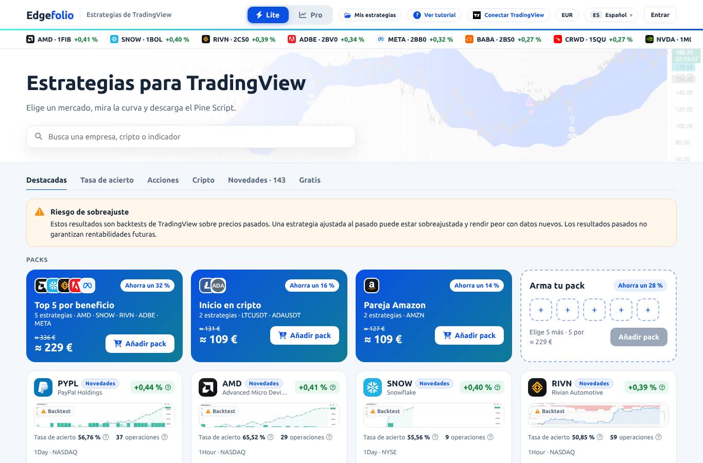
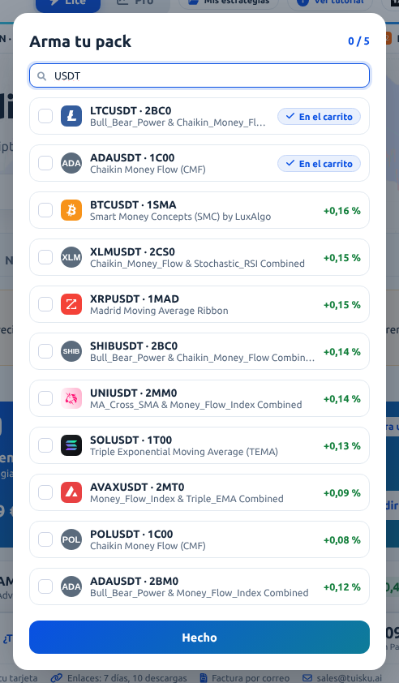
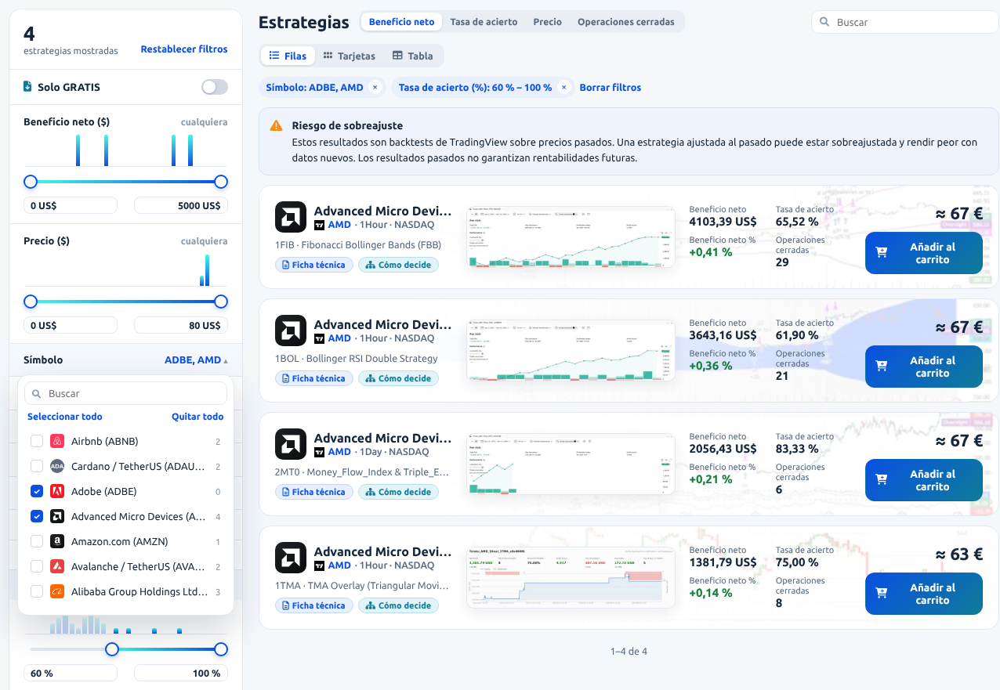
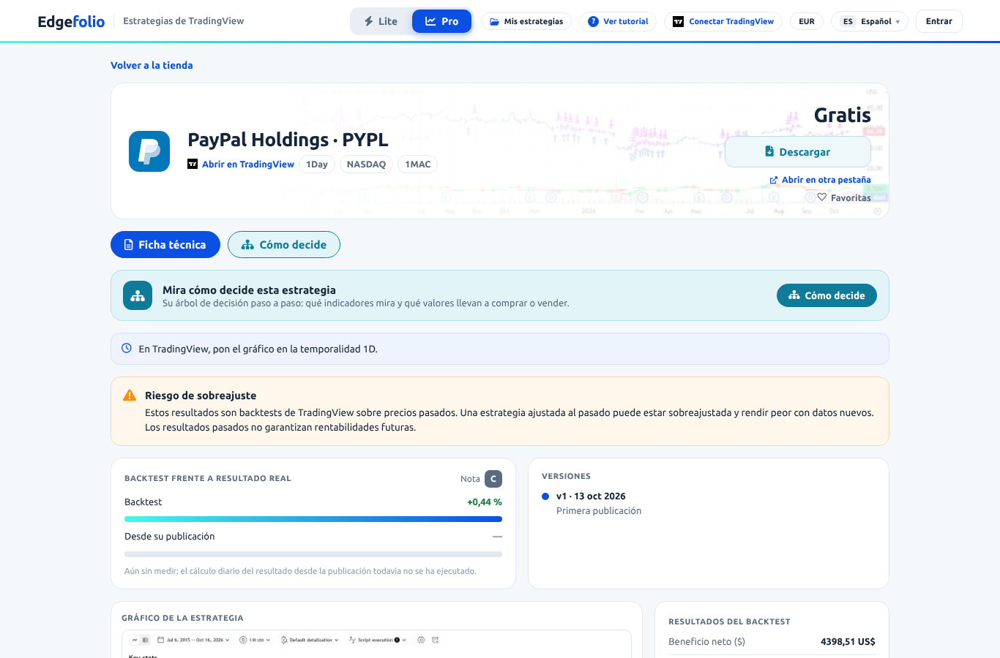
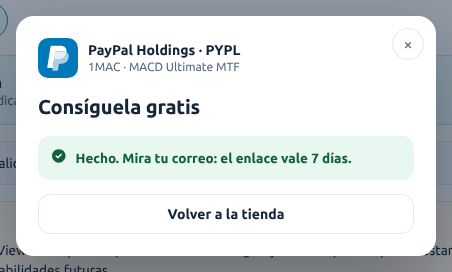
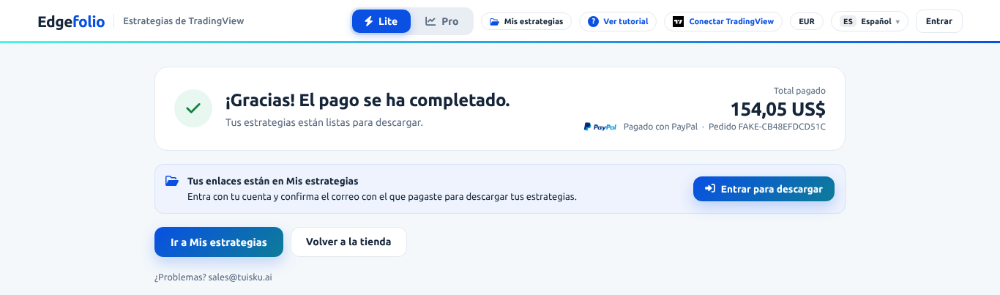
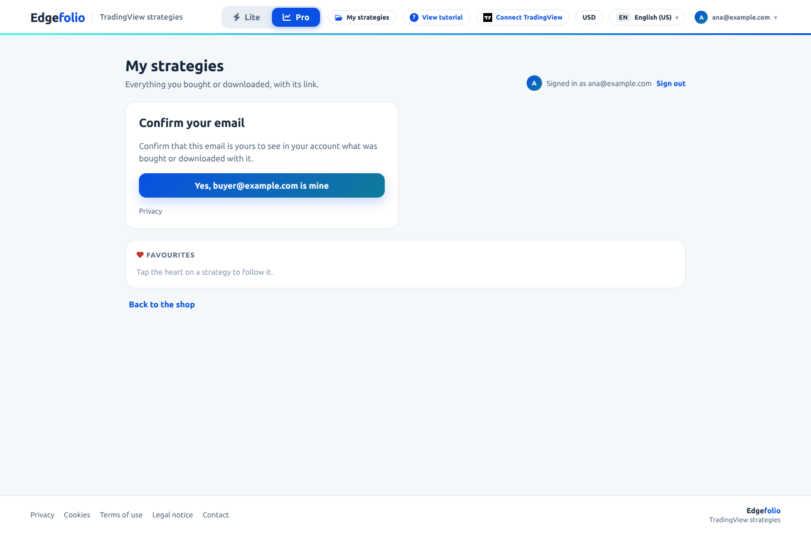
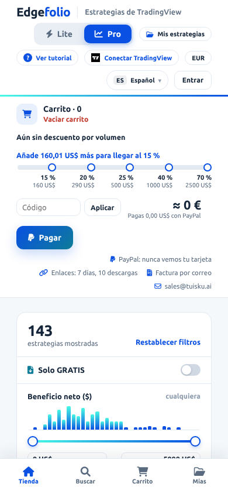
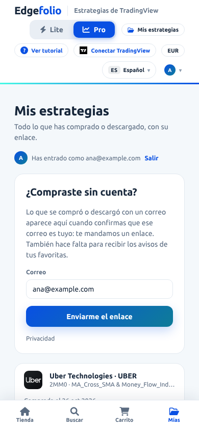

# Edgefolio · Flujo de usuario (la tienda en `_ztool_dev`)

- **Qué es:** cómo funciona hoy la tienda, paso a paso. Leído del código de `_ztool_dev` el 12 oct 2026, recorrido en un navegador (1366 px y 390 px) y corregido el 25 y el 26 oct 2026, con los arreglos de ese recorrido.
- **Documentos hermanos,** con la misma numeración de pantallas (1–9):
  - `docs/PANTALLAS.md`: qué contiene cada pantalla;
  - `docs/API_ENDPOINTS.md`: qué manda y qué recibe cada pantalla.
- **Llamadas al servidor:** cada paso dice cuál hace. El número (API #7) es el de `docs/API_ENDPOINTS_referencia.md` y `docs/API_ENDPOINTS.md`.
- **Repositorio:** `Leci37/tuisku_strategy_store` (antes `tuisku_Web_selling`), rama `_ztool_dev`, núcleo zlecitool-core 0.31.2.
- **Catálogo:** el de 2026-10, 143 estrategias (133 de pago y 10 gratis) de 38 tickers, todas publicadas el 13 oct 2026.
- **Del núcleo, desde la 0.23:** entrar con un enlace por correo (0.26) y con una llave de acceso (0.31), el menú de la cuenta, el sitio de la barra de abajo medido por el núcleo (0.28) y «Mis datos» (0.30).
- **Sustituye** al `docs/FLUJO_USUARIO.md` del repositorio, que era el flujo del diseño (exportación del 6 oct; ahora en `docs/design/FLUJO_USUARIO.md`).
- **Diferencias con el diseño:** cada pantalla las apunta en «Distinto del diseño». Vienen de `docs/handoff/2026-10-06/CAMBIOS.md` o del código.
- **Decisiones del dueño:** lo que aún está por decidir lo dice cada pantalla, y la lista entera está en «Las preguntas abiertas» de `CAMBIOS.md`.
- **Textos:** entre comillas, los de la página en español. Los que solo tiene la tienda, a veces por su clave de `i18n/ui.json`.

**Etiquetas:**
- **[Servidor]:** lo decide el servidor.
- **[Navegador]:** lo guarda este navegador (localStorage).
- **📱:** diferencia en el móvil (390 px) frente al escritorio (1366 px).

---

## Común a todas las pantallas

**Archivos:**
- `templates/edgefolio/shop.html`: una sola plantilla para todas las direcciones, dentro de `zt/base.html` del núcleo.
- `static/js/app.js`: el estado, las llamadas y las acciones.
- `static/js/lib/vals*.js`: pasan el estado a los valores que leen las vistas.
- `static/js/lib/modal.js`: el teclado de los diálogos.
- `static/js/views/*.js`: las vistas, con el marcado del diseño.

Sin sesión: «Edgefolio» y «Estrategias de TradingView» (núcleo), Lite | Pro y Mis estrategias, Ver tutorial, Conectar TradingView y EUR (tienda), el idioma y «Entrar» (núcleo). Debajo, la cinta.

**Barra superior.** Es del núcleo: «Edgefolio» y, al lado, el nombre de la herramienta («Estrategias de TradingView», en el idioma de la página), que llevan a `/` recargando la página; el menú de idioma («ES Español»), la cuenta y la raya. Sin sesión, la cuenta es «Entrar». Con sesión, la inicial y el correo; su menú: Mi cuenta, Créditos, Historial de créditos, Contacto y Salir (los créditos son del núcleo: la tienda cobra con PayPal). Lo de la tienda va en sus dos huecos:
- al principio, **Lite | Pro** y **Mis estrategias**;
- antes del idioma, **? Ver tutorial**, **TradingView** y la **moneda**.

| Elemento | Clic → resultado |
|---|---|
| **Lite \| Pro** | Cambia de modo [Navegador `tuisku-sf-mode`] y va a la tienda desde cualquier página. Es un grupo de radio: las flechas también cambian de modo |
| **Mis estrategias** | Con sesión, pantalla 8, sin recargar. Sin sesión, va a `/mine` y el núcleo manda a `/login?next=/mine` (pantalla 8, «Entrar»). Después vuelve a `/mine` |
| **? Ver tutorial** | El recorrido de bienvenida, desde el paso 1 (pantalla 1), encima de la página en la que se está (también la ficha, Gracias o Mis estrategias), como en el diseño. El paso 1 dice lo de Lite o lo de Pro, según el modo |
| **TradingView** | Apagado dice «Conectar TradingView». Al pulsarlo abre tradingview.com en otra pestaña y pasa a «TradingView ● Conectado» (título «Desconectar»); se recuerda [Navegador `edgefolio-tv`]. Al apagarlo no abre nada. No conecta nada: TradingView no tiene una API para eso |
| **Moneda** | Alterna entre la moneda del idioma y USD: EUR en es, pt, fr y de; INR en hi; CNY en zh; SAR en ar. En la moneda del idioma los precios van redondeados y con «≈» («≈ 67 €»), y el carrito dice lo que se paga en USD («Pagas 73,00 US$ con PayPal»). Usa los cambios de API #5. En inglés (su moneda es USD), o si API #5 no llega, se queda en USD, desactivado (`aria-disabled`): el clic no hace nada. No se guarda: al recargar, otra vez la del idioma |
| **Idioma** (núcleo) | Ocho idiomas, cada uno con su código («ES Español»). La primera vez, el del navegador; si no es uno de los ocho, español. Cambia la página al momento, sin recargar (evento `zt:language`): textos, barra, pie y título de la pestaña. El árabe va de derecha a izquierda, con cifras latinas. Se recuerda en la cookie `zt_lang` y, con sesión, en la cuenta, que manda. Esc lo cierra el núcleo, no la tienda |
| **Entrar** (núcleo) | Va a `/login` y, después, a la dirección con la que se llegó a la página, no a la de ahora: si se ha ido a otra ficha sin recargar, vuelve a la primera. Lo mismo el `from=` de Contacto. Pedido al núcleo en `CAMBIOS.md` («Para el núcleo» 9) |

- **Página:** 1320 px de ancho, con bandas a todo el ancho bajo la barra.
- **Pie (núcleo):** Privacidad, Cookies, Condiciones de uso, Aviso legal y Contacto (el formulario del núcleo, `/contacto`). A la derecha, «Edgefolio» y debajo «Estrategias de TradingView»; el título de «Edgefolio» dice la versión del núcleo.
- **Sin anuncios ni aviso de cookies** (`tool.json`: `"ads": false`).
- **Título de la pestaña:** «Edgefolio · Estrategias de TradingView»; en la ficha, la estrategia (pantalla 3).
- **Precios** [Servidor]:
  - PayPal, en USD, sin créditos (`tool.json` no tiene `"prices"`).
  - Cada precio, descuento y total lo calcula el servidor (API #7).
  - Ningún código de descuento llega a la página.

**Direcciones:**

| Pantalla | Dirección | Qué hace el servidor |
|---|---|---|
| Tienda | `/` | — |
| Ficha | `/s/<id>` | Un id que no existe → 302 a `/`, sin aviso. Un alias o una clave → 301 a `/s/<id>` |
| Cómo decide | `/s/<id>/tree` | Igual que la ficha |
| Gracias | `/thanks?token=<pedido>` | — (la página cobra el pedido, API #9). Sin `token`, vuelve a la tienda. Con un pedido que no existe, la tienda y el aviso `errUnknownOrder` («No encontramos ese pedido.») |
| Mis estrategias | `/mine` | Pide sesión |

- Atrás, Adelante y recargar mantienen la página.
- Con una barra al final (`/s/<id>/`, `/mine/`, `/thanks/`), y en cualquier otra dirección, sale la página «Esta página no existe.» del núcleo.
- Los enlaces antiguos `#s=<id>` siguen abriendo la ficha, y `#s=<id>/tree`, Cómo decide. La dirección se queda con el `#s=`; con un alias pasa a `/s/<id>`. Con un id que no existe, la tienda y el aviso `errUnknownStrategy` («No encontramos esa estrategia.»).

**Al llegar:**
1. Llegan los textos del núcleo (`zt.i18nReady`). **Hasta que llegan, no se pinta nada de la tienda.**
2. A la vez se llaman API #1 (configuración), #4 (packs), #5 (cambios) y #2 (la cinta, en cualquier pantalla); en la tienda, también #2 de su lista. Si la página llegó con sesión, también #14. Después, API #3 de cada estrategia que la página nombra y aún no tiene: las de los packs, el carrito, el pack propio, Comparar y las favoritas (en una visita nueva, hoy, las 9 de los tres packs).
3. Con sesión, las favoritas guardadas en el navegador pasan a la cuenta (API #21, una llamada por favorita). Una que ya no está en el catálogo (404) se borra del navegador, sin aviso. Si el servidor rechaza otra, se queda en el navegador para la próxima vez y sale un aviso. Después, en cualquier pantalla, se piden Mis estrategias y las favoritas de la cuenta (API #15), que sustituyen a las de este navegador; si falla, sale un aviso, y sin sesión (401) va a `/login`.
4. La dirección decide la pantalla. Estos parámetros valen una vez y se borran de la barra de direcciones:
   - `?checkout=cancel`: se vuelve de PayPal sin pagar, y el carrito sigue igual.
   - `?link=<clave>`: un enlace de descarga que ya no vale. Sale un aviso con el motivo.
   - `?news=confirmed` / `?news=expired`: sale el aviso de las novedades.
   - `/mine?proof=<token>`: lleva a la pantalla 8, a demostrar un correo.
5. Una estrategia guardada que ya no está en el catálogo (API #3 contesta 404) sale, sin aviso, del carrito, del pack propio, de Comparar y de las favoritas de este navegador. Si era la de la dirección, la tienda y el aviso `errUnknownStrategy`.

**Avisos** (los de la tienda; el diseño no tiene avisos):
- Cada rechazo del servidor sale como un aviso flotante, «No se pudo hacer» y su texto traducido. Se queda hasta pulsar su ×: no se va solo y Esc no lo cierra. Hay uno cada vez: uno nuevo sustituye al anterior.
- Los de las novedades («Suscripción confirmada», «Ese enlace de confirmación ha caducado») y el de un correo ya demostrado («Ya está confirmado», pantalla 8) van en el mismo sitio, con su propio título e icono, y esperan a que se cierre un rechazo.
- Su × se llama «Cerrar» (`dialogClose`, del núcleo), para un lector de pantalla.
- En Lite van encima del carrito flotante y de la píldora Comparar; la página mide su alto.
- Con un diálogo abierto, van arriba, y el diálogo les deja su sitio (baja o se acorta): un aviso nunca tapa un diálogo. Al cerrarlo, vuelven a su sitio.

**Estados al llegar:**
- **Cargando:** se ven la barra y el pie del núcleo, sin los chips de la tienda (Lite | Pro, Mis estrategias, Ver tutorial, TradingView y la moneda). El contenido queda en blanco hasta que llegan los textos; las llamadas de la tienda ya han salido.
- **Error:**
  - si los textos no llegan, sale `errShopNetwork` («No hay conexión con la tienda. Comprueba tu internet e inténtalo de nuevo.»), escrito por el servidor en la plantilla; el resto del contenido se queda en blanco;
  - si falla otra llamada del arranque, la página se pinta con un aviso: `errLater` (el servidor falla), `errShopNetwork` (sin red) o `errTooMany` (429);
  - sin API #5, todo en USD y sin aviso.
- **Sin JavaScript:** la barra y el pie del núcleo, sin los chips, y el texto `noScript` («Edgefolio necesita JavaScript para enseñar las estrategias.»).
- **Hecho:** la pantalla de la dirección.

**Distinto del diseño:**
- Direcciones de verdad, en lugar de `#s=`.
- La barra, el idioma, la cuenta y el pie son del núcleo:
  - con sesión en el escritorio, la barra enseña el correo entero de la cuenta y solo cabe en una fila con un correo corto: hasta unos 136 px en español (unos 23 caracteres; «cuenta@example.com» cabe) y unos 145 px en inglés. Con uno más largo baja a dos filas (88 px en lugar de 59) a 1366, 1440 y 1600 px, y «Lite | Pro» pasa a la segunda. Está pedido al núcleo en `CAMBIOS.md` («Para el núcleo» 6);
  - el idioma lleva su código («ES Español»), no una bandera.
- 📱 Igual que en el diseño, a 390 px la barra ocupa cuatro filas (165 px; cinco en portugués) y se queda fija arriba al bajar. Con sesión también son cuatro: de la cuenta solo se ve la inicial.
- El chip de TradingView empieza apagado; la maqueta lo enseña encendido, como ejemplo.
- El chip de la moneda no cambia nada en inglés ni sin cambios; en el diseño cambia siempre.
- En árabe, los importes en USD se leen «US$ 172.25» y el chip del descuento de Lite, «−15%»; el diseño los pinta «$US 172.25» y «35%−».
- Los avisos flotantes son de la tienda.

<table>
<tr>
<td width="50%"></td>
<td width="50%"></td>
</tr>
<tr>
<td>En árabe, de derecha a izquierda, con los precios en moneda local.</td>
<td>En español, con los precios en euros. El idioma lo cambia el menú del núcleo, al momento.</td>
</tr>
</table>

---

## 1 · Lite (por defecto)

**Archivos:** `static/js/views/lite.js`, `views/dialogs.js` (el recorrido y el selector del pack), `lib/vals_shop.js`, `lib/vals_cart.js`, `lib/vals.js` (cada tarjeta) y `lib/vals_pages.js` (el recorrido).

<table>
<tr>
<td width="50%"></td>
<td width="50%"></td>
</tr>
<tr>
<td>Al llegar, con el carrito vacío: la cinta, el titular con el buscador, las pestañas con «Novedades · 143», el aviso, los packs con «Arma tu pack» y las primeras tarjetas.</td>
<td>Lite con tres estrategias en el carrito y el código «demo20»: −35 % (15 % del tramo y 20 % del código).</td>
</tr>
</table>

### Recorrido de bienvenida

El paso 1, con seis logos de tickers que vende el catálogo: MSFT, NVDA, AMZN, ADBE, BTC y SOL.

- Es el de la tienda, no el del núcleo, porque el del núcleo solo sale con sesión.
- Sale en la tienda la primera vez que se carga `/` desde este navegador [Navegador `edgefolio-tour-v1`]. Si se entra por otra dirección (una ficha, `/mine`), no sale ni queda como visto. Pasar a la tienda sin recargar (Lite, Pro, «Volver a la tienda») tampoco lo abre: sale la próxima vez que se cargue `/`.
- Tiene 3 pasos, cada uno con «Paso N de 3»:
  1. «Elige un mercado», con el texto de Lite o el de Pro. El de Pro no lleva cifra: «Acota el catálogo con los filtros del panel: beneficio neto, precio, símbolo, temporalidad, indicadores y 16 más.»;
  2. «Lee la curva»;
  3. «Compra y cárgala en TradingView».
- **Controles:**
  - **Continuar**, **Atrás** (desde el paso 2) y **Empezar** (paso 3);
  - **×**, **Esc** o **Empezar** lo cierran y lo dejan como visto; un clic en el fondo oscuro no lo cierra;
  - **→ / ←** cambian de paso (al revés en árabe), y se paran en el primero y en el último;
  - un toque en la imagen avanza, y deslizar más de 40 px cambia de paso, con el dedo o con el ratón: también si empieza en la curva o en un logo, o si acaba fuera de la imagen;
  - abierto, la página de detrás no se toca ni se desplaza, y el foco empieza en **Continuar** (en una pantalla táctil, en el propio recorrido). Si se abrió solo, al cerrarlo el foco va a la página (`<main>`); con «Ver tutorial», vuelve al chip.

### La lista

| Zona | Qué pasa | Llamada |
|---|---|---|
| **Cinta** | 12 estrategias de pago, en orden `hot`: el mejor % de cada ticker, por turnos. No se pulsa. No se mueve sola: se desliza de lado | API #2 `paid=1&sort=hot&size=12` |
| **Buscador** | Busca al escribir en el nombre, el ticker, el indicador y la clave. No distingue mayúsculas ni cuenta los espacios de los lados. Busca trozos de palabra: «eth» encuentra las 26 cripto, porque todas se llaman «… / TetherUS». Va dentro de la pestaña marcada, y cambiar de pestaña no borra lo escrito. Admite hasta 100 caracteres, lo que acepta el servidor | API #2 `q=…` (100 como mucho), 150 ms después de la última tecla |
| **Pestañas** | En este orden: Destacadas (`hot`, también las gratis), Tasa de acierto (`win`, de más a menos acierto), Acciones, Cripto, **Novedades · N** (las publicadas en los últimos 30 días; N = `counts.new`, del catálogo entero) y Gratis. Salvo Tasa de acierto, todas en orden `hot`. Pulsar la pestaña marcada vuelve a pedir su primera página, con la búsqueda de ahora | API #2 `tab=…` |
| **Lista** | 24 tarjetas. «Mostrando N de M», con el total del servidor | API #2 `size=24&page=1` |
| **Ver más** | Añade las 24 siguientes. Solo sale mientras queda algo | API #2 `page=2…` |
| **Aviso de sobreajuste** | Siempre visible | — |

Solo cuenta la respuesta más nueva: una búsqueda vieja que llega tarde no pisa la nueva.

### Packs

- Los packs y el pack propio salen cuando llega API #4; hasta entonces, o si falla (un aviso), no hay sección «Packs».
- **Packs del catálogo** (API #4, de `catalogue/bundles.json`). Hoy, tres: «Top 5 por beneficio» (5 estrategias, 249 US$), «Inicio en cripto» (2, 119 US$) y «Pareja Amazon» (2, 119 US$).
  - cada uno muestra un icono por ticker, su nombre, «N estrategias · TICKERS», el «antes» tachado (sus estrategias sueltas), el precio y «Ahorra un N %»;
  - para los iconos y los tickers, la página pide cada estrategia que aún no tiene (API #3);
  - no sale un pack que perdió una estrategia, ni uno que no es más barato que sus estrategias por separado.
- **Añadir pack:** entra en el carrito [Navegador]. Su botón pasa a «✓ En el carrito»; pulsarlo otra vez lo saca.
  - Sus estrategias sueltas salen del carrito.
  - También salen los packs que comparten alguna estrategia con él.
  - [Servidor] Un carrito con la misma estrategia en dos packs se rechaza (`errBundleOverlap`).
- **Pack propio** («Arma tu pack», `packTitle`): 5 estrategias por 249 US$ (`PACK_SIZE`, `PACK_PRICE`).
  - Su «Ahorra un N %» compara 249 US$ con 5 × el precio mediano de las estrategias de pago (API #4; hoy 345 US$, un 28 %). Con el pack en el carrito, con la suma de las 5 elegidas (API #7). No enseña un precio tachado.
  - El selector («Arma tu pack», «N / 5») se abre con cualquiera de los 5 huecos, o con **Añadir pack** mientras faltan. Busca en todo el catálogo de pago (API #2 `paid=1&sort=hot&size=40&q=…`, hasta 100 caracteres) y enseña hasta 40 estrategias, con las elegidas arriba.
  - Se puede marcar una estrategia que ya va en un pack del carrito, que sale marcada «✓ En el carrito». Al añadir el pack propio, ese otro pack sale del carrito.
  - Con 5 elegidas, otra no se marca (sin aviso).
  - Al abrirse, el cursor va a su buscador (en una pantalla táctil, no). No tiene ×: **Hecho** o **Esc** lo cierran y devuelven el foco al «+» o a **Añadir pack** que lo abrió. Un clic en el velo no lo cierra (ni Comparar, ni la gratis), como en el diseño.
  - El pack propio solo va al presupuesto con las 5 elegidas: con menos, **Añadir pack** sale gris y abre el selector. Quitar una de las 5 saca el pack del carrito; hay que volver a añadirlo.
  - [Servidor] Cuesta 249 US$, o la suma de sus precios si es menor (con los precios de hoy, de 48 a 73 US$, no pasa).

<table>
<tr>
<td width="50%"></td>
<td width="50%"></td>
</tr>
<tr>
<td>Buscando «USDT», con «Inicio en cripto» en el carrito: sus dos estrategias dicen «✓ En el carrito» y se pueden elegir.</td>
<td>Con las cinco elegidas, arriba.</td>
</tr>
</table>

### Tarjetas

| Elemento | Clic → resultado |
|---|---|
| Ticker o curva | La ficha (pantalla 3). El nombre bajo el ticker no hace nada |
| «?» de cada cifra | Una burbuja con la explicación, sobre la curva y la fila de cifras (una a la vez). Se cierra con su × («Cerrar») o, la del beneficio, con el mismo «?». Esc y un clic fuera no la cierran, y mientras está abierta tapa los «?» de acierto y de operaciones |
| **Nota** A–D | [Servidor] Según las operaciones cerradas: A desde 300, B desde 100, C desde 30, D por debajo. Al pasar el ratón, la explicación («Muestra: N operaciones cerradas…»); 📱 sin ratón no se ve. Hoy todas son C (35) o D (108): ninguna pasa de 63 operaciones. Los cortes están por decidir (`CAMBIOS.md`) |
| «Novedades» | Sale si `is_new` [Servidor, `NEW_DAYS`]. Hoy, en todas |
| «Desde su publicación» | El `live` del servidor. Mientras no haya cálculo diario (hoy no lo hay: ningún trabajo escribe `since_release.csv`), «—», sin explicación en la tarjeta; el porqué (`liveUnknown`) sale en la ficha |
| ♡ | Sin sesión, se guarda en el navegador [`edgefolio-favs-v1`]. Con sesión, API #21 / #22; si el servidor no lo guarda, vuelve como estaba y sale el aviso |
| Comparar | Hasta 3 estrategias; la cuarta no entra, sin aviso. No se guarda: al recargar se pierde. Sale la píldora **Comparar · N**, abajo a la izquierda o, si el carrito tiene algo, encima del carrito flotante; sin recargar, sigue en la ficha, Cómo decide, Gracias y Mis estrategias, y abre Comparar encima de ellas. El diálogo, en la pantalla 2 |
| **Ficha técnica** / **Cómo decide** | Pantallas 3 y 4 |
| **Comprar** / «✓ En el carrito» | Entra en el carrito o sale de él [Navegador `edgefolio-cart-v1`]. Si va dentro de un pack, quita el pack. Cada cambio pide presupuesto (API #7) |
| **Descargar** (gratis) | Pantalla 6 |

Las imágenes de las tarjetas son miniaturas WebP (API #6).

**El carrito flotante** se explica en la pantalla 5.

**Estados:**
- **Vacío:** «Ninguna estrategia coincide» (`noMatch`) y, debajo, «Mostrando 0 de 0», sin **Ver más**. Las pestañas, el aviso y los packs siguen.
- **Cargando:**
  - la primera vez, la lista sale vacía, sin indicador; los packs, hasta que llega API #4;
  - al cambiar la búsqueda o la pestaña, se ve la lista anterior hasta que llega la nueva.
- **Error:** un aviso con el motivo («El servicio no respondió…»; sin red, «No hay conexión con la tienda…»). La lista anterior se queda, aunque la pestaña nueva ya sale marcada. Para volver a intentarlo, se pulsa otra vez la pestaña marcada. Si falla **Ver más**, el botón sigue para volver a intentarlo.
- **Hecho:** las tarjetas y el contador.

**📱 (390 px):**
- Las pestañas se desplazan de lado: «Cripto» queda cortada en el borde, y «Novedades · N» y «Gratis», fuera hasta deslizar.
- Los packs, «Arma tu pack» y las tarjetas van en una columna.
- El carrito flotante va encima de la barra de abajo y mide unos 240 px con su fila de PayPal, enlaces y factura; la píldora Comparar, dentro de él, encima.
- El recorrido y el selector del pack ocupan el ancho menos 16 px por lado.
- Los «?» de acierto y operaciones (13 px de alto), **Ficha técnica** y **Cómo decide** (20 px) son pequeños para un dedo.

**Distinto del diseño:**
- Cifras de verdad:
  - el total de la lista;
  - «Novedades · N», que hoy es 143: todo el catálogo se publicó el 13 oct 2026 y sale en Novedades hasta el 12 nov 2026; después, 0;
  - «Desde su publicación», que sale como «—».
- 24 tarjetas por página (el diseño enseña 8); «Ver más» funciona, y el selector del pack busca en todo el catálogo.
- Los packs son los de `catalogue/bundles.json`, no los del diseño, y salen cuando llegan (el diseño no espera).
- El paso 1 de Pro no lleva cifra y dice «16 más» (el diseño: «las 2.834 estrategias» y «15 más»).
- Los logos del paso 1 son de tickers del catálogo (el diseño traía Apple y Ethereum, que no se venden).
- Los diálogos se quedan con el teclado (ver «Teclado»).
- Los buscadores admiten 100 caracteres.

---

## 2 · Pro

**Archivos:** `views/pro.js`, `lib/filters.js` (arma la consulta) y `lib/vals_shop.js`.

**Panel de filtros** (📱 encima de la lista). Cada cambio de filtro, de orden o de búsqueda vuelve a pedir la lista (API #2) 150 ms después del último cambio, con `facets=1` (histogramas y recuentos). Al pasar de página o con «Ver más», sin `facets`.
- El recuento («143», y debajo «estrategias mostradas»; con una, «1 estrategia mostrada») y **Restablecer filtros**. Hace lo mismo que **Borrar filtros**: quita los rangos, los desplegables, «Solo GRATIS» y la búsqueda, y pliega lo abierto. El orden y la vista se quedan.
- **Solo GRATIS** → `free=1`.
- **16 rangos** → `<clave>_min` / `<clave>_max`. Las claves son `np`, `price`, `npp`, `trades`, `win`, `pf`, `months`, `mlu`, `mlp`, `avg`, `avgp`, `bars`, `act`, `candles`, `prec` y `tree`.
  - Los histogramas y la escala de cada barra los da el servidor, y salen del catálogo: cada barra va del mínimo al máximo de sus estrategias, redondeados hacia fuera. Con el de 2026-10: Operaciones cerradas 0–70, Beneficio neto ($) 0–5000 US$, Beneficio neto (%) 0–0,5 % y Actividad por vela 0–0,3.
  - Solo pueden ir en escala logarítmica los rangos que el diseño pone así (Beneficio neto en $ y en %, Factor de beneficio y Beneficio medio en $), y solo si sus valores abarcan más de dos órdenes de magnitud: hoy, solo Factor de beneficio (1–200).
  - Cada histograma cuenta con todos los demás filtros, pero sin el suyo.
  - Un asa en el extremo no manda nada: quiere decir «sin límite».
  - Hasta que llega la primera respuesta, las cajas de mínimo y máximo salen vacías; lo que se escribe o se arrastra antes conserva su valor cuando llega la escala del catálogo.
  - Las etiquetas y las cajas enseñan la cifra que se manda: Factor de beneficio, con hasta dos decimales por debajo de 10; Beneficio medio (%), con dos por debajo de 10; Actividad por vela, con hasta tres.
  - «Actividad por vela» (`act`) son las operaciones por vela del backtest: la columna `Trade Activity Per Candle` del catálogo, de 0,002 a 0,238.
  - Una estrategia sin el dato no pasa un rango activo de ese dato. Por ejemplo, SPOT 1Day 1FIB no tiene factor de beneficio.
  - Beneficio neto ($) y Precio ($) están siempre abiertos. Los otros 14 se despliegan de uno en uno: abrir uno pliega el anterior, y otro clic lo pliega. Sin límite dicen «cualquiera»; un rango activo sale en negrita, con sus valores.
  - **Casillas mín. y máx.:** se aplican con Intro o al salir de la casilla. Aceptan la coma decimal y «$» o «%», y se redondean a lo que muestra la etiqueta (70,5 → 71 US$). Si no es un número, no se manda nada y vuelve el valor anterior. Un mínimo por encima del máximo se queda en el máximo, y el extremo de la barra no pone límite.
- **5 desplegables** → `sym`, `tf`, `ind`, `idx` y `rel`, repetidos tantas veces como opciones marcadas. Con todas marcadas (al llegar) no se manda nada; quitar una manda las demás.
  - La fila dice «N seleccionados» («1 seleccionado» con una: hoy, la Fecha de publicación, con una sola fecha); con una o dos elegidas, sus nombres; sin ninguna, «—».
  - Las opciones, su recuento y los iconos los da el servidor. El buscador del desplegable filtra las opciones en la página, sin llamar al servidor.
  - **Quitar todo** manda la clave vacía (`sym=`) y la lista se queda vacía («Ninguna estrategia coincide», «0–0 de 0»). **Seleccionar todo** quita el filtro.
  - Abierto, tapa las filas de debajo. Se cierra con Esc (el foco vuelve a su botón) o con un clic fuera (también en su fila); ese clic solo cierra: no ordena ni abre otro desplegable.
- [Servidor] Los filtros se combinan con Y, y las opciones de un mismo desplegable, con O.

Dos símbolos (ADBE y AMD) y la tasa de acierto desde el 60 %: «4 estrategias mostradas», las etiquetas con «Borrar filtros», los histogramas y la lista salen del servidor.

**Encima de la lista:**
- **Pestañas de orden** (Beneficio neto, Tasa de acierto, Precio, Operaciones cerradas; sin rótulo «Ordenar») → `sort`, siempre de mayor a menor: en Precio, la más cara primero.
- El buscador → `q` (hasta 100 caracteres), una vez, 150 ms después de la última tecla.
- **Filas / Tarjetas / Tabla** [Navegador `tuisku-sf-pview5`].
- Una etiqueta por filtro activo, con su × («Quitar» y el filtro): también «Solo GRATIS» y la búsqueda («“texto”»); un desplegable sin nada marcado sale «Símbolo: —». **Borrar filtros** lo quita todo, búsqueda incluida (como **Restablecer filtros**).
- Los filtros, el orden, la búsqueda y la lista de Comparar no se guardan: siguen al abrir una ficha y volver con Atrás, o al pasar por Lite, pero se pierden al recargar. La vista sí se recuerda.

**Vistas:**
- **Filas** y **Tarjetas:** 25 por página; «Ver más» añade la página siguiente («1–50 de 143»).
- **Tabla:**
  - 25 por página, fijas («Filas por página 25 ▾» no se cambia), y el paginador cambia de página («a–b de N»). Si se llega desde Filas o Tarjetas después de «Ver más», sale la última página cargada;
  - las cabeceras numéricas ordenan, de mayor a menor. Beneficio neto %, Beneficio medio y Meses de entrenamiento solo se ordenan desde aquí: con ellos, ninguna pestaña de orden queda marcada, tampoco en Filas;
  - un clic en una fila (fuera de sus botones) la despliega, una cada vez, y otro la pliega; con el teclado, **Intro** o **Espacio** en su ticker, que es un botón (`aria-expanded`). Desplegada, enseña sus dos gráficos y la explicación del indicador, con **Abrir en TradingView** (la página del símbolo), **Ficha técnica** y **Cómo decide**, que se quedan en la parte visible aunque la tabla se desplace de lado; 📱 en una columna;
  - Comparar y el carrito (o Descargar) van al final de la fila;
  - es más ancha que la lista y se desplaza de lado también en el escritorio (a 1366 px, unos 1.744 px en español).
- «CLAVE · indicador»: en Tarjetas abre la página del indicador en TradingView (`ind_url`); en Filas y en la Tabla es texto. Al pasar el ratón, sale su explicación (`ind_text`, en inglés en todos los idiomas: viene del catálogo).

Una fila desplegada: los dos gráficos, el texto del indicador (en inglés), «Abrir en TradingView», «Ficha técnica» y «Cómo decide».

**Comparar:**
- Admite hasta 3 estrategias, desde las tarjetas de Lite y desde la Tabla de Pro (Filas y Tarjetas de Pro no lo tienen). Una cuarta no entra, sin aviso.
- La píldora **Comparar · N** (en Pro, abajo a la izquierda, sobre el panel; a la derecha en árabe) abre la tabla comparativa, con el mejor valor de cada fila en verde. En el precio, gana el más bajo; si empatan, todas en verde. «Desde su publicación» sale «—» y no gana nadie.
- Al abrirse, el foco va a su ×. La × de cada columna («Quitar TICKER · CLAVE») la quita; **Esc** o la × de arriba («Cerrar») lo cierran, y el foco vuelve a la píldora. Sin estrategias, se cierra solo y el foco va a la página.
- No llama al servidor, y la lista se pierde al recargar.

**La franja del carrito y la escalera** se explican en la pantalla 5.

**Estados:**
- **Vacío:** «Ninguna estrategia coincide» (`noMatch`) y «0–0 de 0».
- **Cargando:** al llegar, hasta la primera lista, el recuento dice «0», los desplegables no tienen valor, las cajas de los rangos están vacías y abajo sale «0–0 de 0». Después, se ve la lista anterior hasta que llega la nueva.
- **Error:** un aviso («No se pudo hacer» y el motivo; sin conexión, `errShopNetwork`), que se queda hasta cerrarlo con ×. La lista, el recuento y los histogramas anteriores se quedan, aunque el buscador y las etiquetas ya muestren lo nuevo. Si falla al llegar, el panel se queda en «0» hasta el siguiente cambio o hasta recargar. Un valor tecleado que no es un número no llega al servidor.
- **Hecho:** la lista.

📱 La franja del carrito (unos 344 px) y el panel de filtros (unos 1.180 px) van antes de la lista: «Estrategias» queda a unos 1.730 px y la primera estrategia, a unos 2.100 px (dos pantallas y media). Para llegar antes, **Buscar** de la barra de abajo lleva al buscador.

**Distinto del diseño:**
- El paginador de la Tabla y «Ver más» funcionan.
- Las filas de los filtros, las cabeceras de la Tabla y el ticker de cada fila de la Tabla son botones (`aria-expanded`, `aria-sort`).
- La fila desplegada de la Tabla se queda en la parte visible (con la rejilla del diseño, del ancho de la tabla, la explicación quedaba fuera).
- Las escalas de los rangos salen del catálogo. Las del diseño (§12) eran las del catálogo de 2024, y las 143 estrategias caían en un rincón de cada barra.
- «Actividad por vela» es la del catálogo. La maqueta, que no tenía esa columna, ponía operaciones por mes de entrenamiento.
- Con una, el recuento y los desplegables van en singular («1 estrategia mostrada», «1 seleccionado»); el diseño dice «1 seleccionados». En inglés, el rango de profundidad sigue diciendo «Tree Deep», como el diseño: anotado para el diseñador en `CAMBIOS.md`.
- Las × dicen lo que quitan («Quitar Símbolo: ADBE, AMD»); en el diseño se llaman «×».
- Hay 68 estrategias (de 143, con los 17 indicadores combinados: 2BB0, 2BT0, 2CS0…) que enlazan a la lista de scripts de TradingView, porque `indicators.csv` no les da página. Su nombre es el del generador, con guiones bajos («Bull_Bear_Power & Triple_EMA Combined»).
- Los buscadores admiten 100 caracteres.

---

## 3 · Ficha de la estrategia (/s/<id>)

**Archivos:** `views/detail.js` y `lib/vals_pages.js`.

**Al abrirla se piden:**
- el registro completo (API #3): el indicador, su enlace y las versiones. También trae su autor (`ind_author`), pero la página no lo enseña;
- la vista previa, de `/static/assets/previews/…pine` (cortada), y los dos gráficos en PNG;
- con sesión, Mis estrategias (API #15), una vez y en silencio: dice si la estrategia ya es de la cuenta y si hay que mostrar «Actualización disponible».

**Qué ve y qué hace:**
1. **Cabecera:**
   - **Volver a la tienda**, el nombre y el ticker;
   - **Abrir en TradingView** abre en otra pestaña la página del símbolo (`tradingview.com/symbols/NYSE-SNOW/`), con `tv_symbol`: `NYSE:SNOW`, o `BINANCE:BTCUSDT` en cripto;
   - la temporalidad (`1Day` o `1Hour`), el mercado (NASDAQ, NYSE o CRYPTO) y la clave.
2. **Compra:** el precio, en la moneda de la barra («≈ 67 €» en español), con **Añadir al carrito** / «✓ En el carrito», o **Descargar** si es gratis (pantalla 6).
   - Al añadirla se pide el presupuesto (API #7). Otro clic en «✓ En el carrito» la quita; si estaba en un pack (o en el pack propio), quita el pack entero (las elegidas del pack propio siguen en su tarjeta).
   - En la ficha no hay carrito: se paga desde la tienda (pantalla 5). 📱 La barra de abajo cuenta lo que hay en el carrito, y **Carrito** lleva a la tienda.
   - **Ya es tuya:** con la sesión abierta, si la estrategia ya es de la cuenta (lo dice API #15), en vez de **Añadir al carrito** (o **Descargar**, en una gratis) sale «Ya es tuya · Descargar» (`ownedYours`), que baja su .pine (gasta una de sus descargas). Si su enlace caducó, se gastó o hay una versión nueva, «Ya es tuya · Mis estrategias», que lleva a Mis estrategias sin recargar la página. El precio sigue encima: si debe quitarse está por decidir.
   - [Servidor] La sigue presupuestando: si está en el carrito (desde las tarjetas de Lite o de Pro), se cobra otra vez. Si el servidor debe negarse lo decide el dueño (`CAMBIOS.md`).
3. **Abrir en otra pestaña** (siempre `/s/<id>`, la ficha técnica) y **♡ Favoritas**: sin sesión se guarda en este navegador [Navegador `edgefolio-favs-v1`]; con sesión, en la cuenta (API #21 al marcarla, #22 al quitarla). No sale aviso, salvo si el servidor no lo guarda.
4. **Pestañas Ficha técnica | Cómo decide.** La dirección pasa a `/s/<id>/tree`; la tarjeta «Mira cómo decide esta estrategia» también abre la pestaña.
5. **Ficha técnica**, de arriba abajo:
   - la tarjeta de «Cómo decide»;
   - la temporalidad que hay que poner en TradingView, con el nombre de su menú: «En TradingView, pon el gráfico en la temporalidad 1D.» (1h en las de 1Hour), como el tutorial de instalación;
   - el aviso de sobreajuste;
   - el backtest frente a «Desde su publicación», con la nota. Las dos barras miden contra el mejor backtest del catálogo (`npp_max`, API #1): hoy PYPL 1Day 1MAC (+0,44 %) llena la barra y SNOW 1Day 1BOL (+0,40 %) llega al 91 %. Mientras «Desde su publicación» sale «—» («Aún sin medir: …»), su barra está vacía;
   - **Versiones**;
   - los dos gráficos;
   - los **14 resultados**, con «—» si falta un dato;
   - **Sobre el indicador:** «CLAVE · nombre», la explicación y «Ver el indicador en TradingView». La explicación sale en inglés en todos los idiomas, marcada como inglés (`lang="en"`): `catalogue/indicators.csv` solo la tiene en inglés;
   - la **vista previa** del Pine Script, cortada;
   - los **formatos**: .pine, .md, .py (beta) y .js (beta).
6. **En una gratis,** la vista previa y los formatos no hablan de comprar: «El resto del script te llega gratis por correo» (`scriptRestFree`), «Lo que recibes: el script completo» (`buyScriptTitleFree`), «Para TradingView. Es lo que te llega por correo.» (`fmtPineDescFree`) y «Formatos incluidos. Te llegan por correo y están en Mis estrategias.» (`formatsNoteFree`).
7. **Versiones** [Servidor]: van de la actual a la 1, y solo la actual lleva fecha. El servidor no manda notas: la 1 dice «Primera publicación» (texto de la tienda) y las demás, nada.
   - «Actualización disponible» sale solo a quien compró una versión anterior (`update` en API #15). En el catálogo de 2026-10 las 143 están en la v1: todavía no sale a nadie.
   - Una descarga gratis renovada ya da la versión nueva.
8. **Título de la pestaña:** «Nombre · TICKER · CLAVE · temporalidad · Edgefolio», por ejemplo «Snowflake · SNOW · 1BOL · 1Day · Edgefolio»; en Cómo decide, «… · 1Day · Cómo decide · Edgefolio». [Servidor] Lo escribe ya en la página, también para la vista previa de un enlace (`og:title`). La página lo cambia al moverse por la tienda y al cambiar de idioma.

<table>
<tr>
<td width="50%"></td>
<td width="50%"></td>
</tr>
<tr>
<td>Una gratis (PYPL 1MAC): «Gratis» y «Descargar», la temporalidad «1D» y la barra del backtest, llena: es el mejor del catálogo.</td>
<td>Una de pago: la vista previa cortada, «El resto del script se entrega tras la compra», y los formatos.</td>
</tr>
</table>

**Estados:**
- **Cargando:** el editor de la vista previa sale vacío hasta que llega.
- **Error:**
  - una dirección `/s/<id>` que ya no existe (por ejemplo, una estrategia del catálogo de 2024) la manda el servidor a la tienda (302), **sin aviso**;
  - con un enlace antiguo `#s=<id>` que ya no existe, o si API #3 contesta 404 con la página ya abierta, sale el aviso `errUnknownStrategy` («No encontramos esa estrategia.») y se vuelve a la tienda;
  - si la vista previa no llega, el editor se queda vacío, sin mensaje.
- **Hecho:** la ficha completa.

📱 Las tarjetas van una debajo de otra, y el editor se desplaza de lado dentro de su caja.

**Distinto del diseño:**
- Toda vista previa pública va cortada, también la de las gratis. El diseño mostraba entera la gratis; está en los puntos a revisar de `API_ENDPOINTS_referencia.md`.
- Las versiones son las del servidor: solo la 1 lleva nota («Primera publicación», como en el diseño) y la nota de la v2 del diseño no sale. Lleva fecha solo la actual (en el diseño, la v1).
- «Desde su publicación» sale como «—», con «Aún sin medir: …»: no hay cálculo diario, y hacerlo está por decidir.
- Las barras del backtest y de «Desde su publicación» miden contra el mejor backtest del catálogo, no contra el 100 %. El diseño las dibujó para sus backtests, la mayoría del 71–86 % (de 0,49 a 85,80 %); con los de 0,03–0,44 % se veían vacías.
- La temporalidad dice el nombre del menú de TradingView («1D»); el diseño escribe «1Day», el del catálogo.
- En una gratis, la vista previa y los formatos no hablan de comprar; el diseño pone los textos de compra también en ella.
- El estado «Ya es tuya» no está en el diseño.
- El título de la pestaña dice qué estrategia es; en la maqueta no cambia.
- La explicación del indicador sale en inglés en todos los idiomas (`catalogue/indicators.csv` solo la tiene en inglés). Traducirla es contenido del dueño.

---

## 4 · Cómo decide (/s/<id>/tree)

**Archivos:**
- `static/js/tree.js`, que se carga al abrir la pestaña;
- `views/tree/*.js`;
- `static/trees/features.json` y `static/trees/ui.json`.

<table>
<tr>
<td width="50%"></td>
<td width="50%"></td>
</tr>
<tr>
<td>La vista Árbol.</td>
<td>La vista Bloques, como visitante: los pasos en columnas, los resultados con su fuerza y la caja con «Comprar para desbloquear».</td>
</tr>
</table>

**De dónde sale el árbol:**
- **Visitante:** de la vista previa cortada: el primer árbol, con sus ramas de pago cerradas.
- **Propietario** (con sesión y la estrategia en Mis estrategias: comprada, o pedida gratis con la sesión abierta o con un correo demostrado): del script entero (API #17), así que el árbol sale completo y se puede elegir cualquier árbol del bosque («Árbol 1 del bosque» pasa a ser un botón por árbol). El recuadro verde dice «Vista de propietario: este es el árbol completo. Descarga el script para usarlo en TradingView.», con **Descargar .pine**.
- Si la estrategia ya es tuya, el árbol abre en la vista de propietario. Al pedir una gratis con la sesión abierta, pasa solo a esa vista, sin recargar.

**Textos e idiomas:**
- Bajo el título, una línea explica el patrón de la estrategia en el idioma de la página: en es y en, de `static/trees/features.json`; en los otros seis, de `pat` en `static/trees/ui.json`. Va en la dirección de la página: en árabe, de derecha a izquierda, aunque empiece por un nombre latino («WaveTrend…»). Un patrón sin traducir todavía saldría en inglés, marcado como inglés (`lang="en"`).
- La descripción de cada indicador (al pasar por encima de una caja, al tocarla o con su «i») solo está en es y en; en los otros seis idiomas sale la inglesa, marcada como inglés. Traducirlas es contenido del dueño.
- **Nombres de los indicadores:** las cajas, los deslizadores y el camino dicen el nombre del indicador si es de uno de los patrones de la estrategia (`static/trees/features.json`; en los otros seis idiomas, `feat` de `static/trees/ui.json`). Un valor del generador de 2026 dividido por el cierre (`macd__close`) lleva el nombre del valor sin `__close`, y su explicación añade «Tal como lo ve el modelo: dividido por el cierre de la vela.». Los que `features.json` no nombra (139 de los 182 que preguntan las vistas previas de 2026-10) salen con su código y «Valor de este indicador tal como se usó al entrenar el modelo.». Escribirlos es contenido del dueño.

**Controles:** los mismos que en el diseño:
- **Árbol | Bloques** (pestañas con `aria-selected`: un lector de pantalla dice cuál está puesta);
- **Visitante | Propietario** (`aria-pressed`): empieza en Propietario si la estrategia es tuya. Si no lo es, Propietario explica cómo conseguirla: sin sesión, con **Entrar** (lleva a `/mine`, no vuelve al árbol); con sesión, que no está entre tus compras. En los dos casos, con **Comprar para desbloquear** (**Conseguirla gratis** en una gratis);
- clic en una pregunta o en su Sí / No;
- los resultados, con su regla (al pasar el ratón; 📱 al tocarlos);
- arrastrar el árbol con el ratón;
- los deslizadores de los indicadores, y **No | Sí** en los que son verdadero o falso;
- la «i» de cada indicador, con su explicación, su valor y sus umbrales. Para un lector de pantalla, la «i» se llama «¿Qué es macd__close?» y la × de una explicación, «Cerrar», en el idioma de la página;
- los ejemplos de compra y venta;
- «Ver todas las reglas en frases (N)» y «Volver a la ficha técnica».

**Botones de compra y descarga:**
- **Comprar para desbloquear** (en el aviso de las ramas de pago, en la caja de Propietario y en el candado de una rama) solo añade al carrito, y lo que dice sigue al carrito de la página: con la estrategia en el carrito (sola, en un pack o en el pack propio ya añadido), «Añadida al carrito», que no la añade otra vez; quitada con el botón de la cabecera, otra vez «Comprar para desbloquear», que la vuelve a añadir. No lleva al carrito.
- **Ya es tuya** (con sesión; lo dice API #15, como en la ficha): en la vista de visitante, el aviso dice «N ramas de este árbol están en la parte de pago. Ya es tuya: el árbol completo y todos los árboles de su bosque están en la vista de propietario.» y el candado de una rama, «Ya es tuya: esta rama y el árbol completo están en la vista de propietario.». Su botón, **Ver como propietario**, pasa a esa vista y deja el foco en **Propietario**. Nunca la añade al carrito ni la pide otra vez, tampoco si es gratis.
- En una estrategia gratis, el árbol dice «Script completo» y «Conseguirla gratis», que abre la pantalla 6. En una gratis que no es tuya, la vista de propietario dice que se pide gratis por correo y con qué correo entrar (el de la petición), con **Entrar** (sin sesión) y **Conseguirla gratis**; nunca «compraste» ni «Cómprala».
- **Descargar .pine** (propietario) abre su enlace de descarga (API #10) o, si no lo tiene, Mis estrategias.

**Estados:**
- **Cargando:** el mensaje de carga del árbol. Para el propietario, mientras llega el script entero (API #17), el recuadro y el candado dicen «Cargando el árbol…», con **Descargar .pine**, sobre el árbol de la vista previa.
- **Error:**
  - si el código del árbol no llega, sale el aviso `errShopNetwork` y la pestaña se queda vacía. Para volver a intentarlo, se pulsa otra vez «Cómo decide» (la pestaña o el botón de la ficha) o se vuelve a su pestaña (desde la ficha, otra página o Atrás): la página lo pide de nuevo, a otra dirección (`tree.js?retry=N`), porque el navegador recuerda el fallo; nunca lo pide sola. Cuando llega, el aviso se va solo. Si lo que no llegó fue una pieza del árbol (`views/tree/…`), hay que recargar la página;
  - si no llegan sus datos, sale el mensaje de error del árbol, con el motivo («No se pudo cargar el árbol: …»);
  - si el script completo del propietario no llega (API #17 contesta `errFileMissing` o falla la red), el recuadro de propietario lo dice en ámbar: «Vista de propietario: no pudimos cargar tu script completo. Descárgalo desde Mis estrategias o inténtalo más tarde.», con **Descargar .pine**. Se ve el árbol de la vista previa, y el candado de una rama ofrece lo mismo; en la vista de propietario, nunca «Comprar para desbloquear». Si el fichero falta en la tienda, **Descargar .pine** lleva a Mis estrategias con el aviso «El fichero de esta estrategia no está disponible ahora. Escríbenos y te lo mandamos.».
- **Hecho:** el árbol.

📱 Los deslizadores van encima del árbol. Tocar una caja abre su explicación y lleva el camino hasta ella; la explicación se queda abierta aunque la página y el árbol se muevan solos justo después, y se cierra con su × o al desplazar la página o el árbol.

**Distinto del diseño:**
- Los resultados se colorean con los niveles con que opera el script, no con los comentarios `// buy|sell` de la vista previa (que marcan ±0,7): el propietario, con los de su script completo (`buyThreshold` y `sellThreshold`, que el generador elige para cada modelo: de 0,4 a 1 para comprar, de −1 a −0,5 para cerrar); el visitante, con 0,55 para comprar y −0,9 para cerrar (los de los scripts de 2024), porque la vista previa se corta antes de esos niveles. Así, al visitante un resultado le puede decir otra cosa que lo que hace el script: en SNOW 1BOL, el −0,83 marcado `// sell` sale «Esperar». Publicar los niveles de cada script, para que el visitante los vea, es decisión del dueño.
- Todos los patrones del catálogo tienen su explicación, en los 8 idiomas; el diseño traía 7, en es y en.
- Si el script del propietario no llega, la tienda lo dice y ofrece descargarlo; el diseño no tiene ese estado.
- Con una estrategia que ya es tuya, la vista de visitante no ofrece comprarla ni pedirla; el diseño no tiene ese estado.
- «Comprar para desbloquear» sigue al carrito de la página; el diseño guardaba su propio «Añadida al carrito».
- «Vista de propietario: este es el árbol completo», sin «primer»: el propietario elige cualquier árbol del bosque.
- En el móvil, la explicación de una caja tocada se queda abierta; en el diseño se cerraba en el acto.
- La «i» y la × de las explicaciones hablan el idioma de la página; el diseño dice «What is …?» y «Close» en todos.
- En árabe, los deslizadores siguen yendo de izquierda a derecha.

---

## 5 · Carrito y pago

**Archivos:** `views/lite.js` (el carrito flotante), `views/pro.js` (la franja) y `lib/vals_cart.js`.

**El carrito** [Navegador `edgefolio-cart-v1`] guarda las estrategias, los packs, el pack propio y el código. Cada cambio pide un presupuesto (API #7) 120 ms después; solo vale la respuesta más nueva. «Carrito · N» cuenta cada estrategia, también las de un pack.

Un carrito del mismo importe que el del diseño (237 US$; allí, tres estrategias de 79 US$): «Inicio en cripto» (119 US$) y dos estrategias de 59 US$, con «demo20»: «15 % de descuento por volumen + 20 % con el código» y «Añade 53,01 US$ más para llegar al 20 %».

| Elemento | Comportamiento |
|---|---|
| «Carrito · N» | — |
| ¿Tienes un código? (Lite) / Código + **Aplicar** | El código va al servidor al pulsar **Aplicar** o con Intro (no mientras se compone en chino o en hindi). Da igual en mayúsculas o con espacios. Según `code_status`, sale «Código de descuento aplicado» o, en rojo, «Código no válido: sin descuento». Un código no válido deja de aplicarse, pero sigue escrito en la casilla. Con el carrito vacío no sale nada hasta que entra algo. Aplicar otra vez el mismo no borra el mensaje, y la casilla vacía quita el código. En Lite, la casilla ya no se cierra, y sale abierta si al llegar hay un código aplicado |
| Escalera (Pro) | Los tramos vienen de API #1. «Añade X más para llegar al Y %» usa `next_tier.missing` (detalle bajo la tabla). Sin tramo, «Aún sin descuento por volumen» (con un código, «Aún sin descuento por volumen + 20 % con el código»); pasado el último, «Descuento máximo alcanzado». Con un código de precio fijo no hay escalera: «Aún sin descuento por volumen», sin «Añade …», y el subtotal tachado si el precio baja |
| Totales | El subtotal tachado solo si hay descuento, y el total. En moneda local, «≈ …» («≈» va pegado al importe: nunca se queda solo al final de una línea) y «Pagas X US$ con PayPal» |
| Fila de confianza | «PayPal: nunca vemos tu tarjeta»; «Enlaces: 7 días, 10 descargas», con las cifras de API #1; «Factura por correo» (es un recibo, ver los puntos a revisar); el correo de contacto (`CONTACT_EMAIL`, sales@tuisku.ai) |
| **Vaciar carrito** (Pro) | Saca del carrito las estrategias, los packs y el pack propio. Las elegidas para «Arma tu pack» siguen en su tarjeta, y el código se queda, con su mensaje |

Sobre la escalera: un tramo cuenta solo por encima de su importe. Por eso dice 53,01 US$ donde el diseño dice 53,00 (con el mismo carrito de 237 US$), y con el carrito vacío dice 160,01 US$.

En moneda local: el total en euros y, debajo, «Pagas … US$ con PayPal». El carrito flotante de Lite, con un código, sale en la pantalla 1.

**Descuentos** [Servidor]:
- Por tramos: más de 160 US$ → 15 %; más de 290 → 20 %; más de 500 → 25 %; más de 1.000 → 40 %; más de 2.500 → 70 %.
- Un código suma su porcentaje al del tramo, con un tope del 70 % para el total: el código quita solo lo que queda hasta el tope. En el tramo del 70 % no quita nada, y la franja de Pro dice solo «70 % de descuento por volumen», sin «+ N % con el código» (sigue diciendo «Código de descuento aplicado»). El presupuesto da lo que quita cada parte después del tope (`tier_rate`, `code_rate`).
- Un código de precio fijo pone ese precio a cada estrategia suelta, y entonces no se aplica el tramo. Los packs y el pack propio se quedan con su precio.

**Pagar:**
1. Con el carrito vacío, no hace nada (Pro enseña **Pagar** también vacío, como el diseño).
2. API #8 crea el pedido en PayPal por el total del servidor. **Pagar** queda ocupado (gris, con una rueda), así que un doble clic no crea dos pedidos.
3. El navegador va a PayPal (`approve_url`).
4. Si se aprueba, PayPal vuelve a `/thanks?token=<pedido>` (pantalla 7).
5. Si se cancela, vuelve a `/?checkout=cancel`: la tienda, en el modo que tenía, con el carrito y el código intactos, sin aviso. Con el botón Atrás del navegador, **Pagar** se libera.

**Estados:**
- **Vacío:** Lite no muestra el carrito; Pro muestra «Carrito · 0», «Aún sin descuento por volumen», «Añade 160,01 US$ más para llegar al 15 %» y un total de 0 (en español, «≈ 0 €» y «Pagas 0,00 US$ con PayPal»).
- **Cargando:**
  - se ve el presupuesto anterior hasta que llega el nuevo;
  - **Pagar** está ocupado mientras se crea el pedido.
- **Error:**
  - código no válido;
  - un aviso con `errPackSize`, `errNothingToPay`, `errPayPal` o `errLater`. Por ejemplo, un pack propio guardado con una estrategia que ahora es gratis da `errPackSize`. Un carrito guardado con solo estrategias que ahora son gratis cuenta 0 US$, y **Pagar** da `errNothingToPay`;
  - `errBundleOverlap` no llega desde la página: al llegar, de dos packs que comparten estrategia se queda el primero;
  - las estrategias o los packs que ya no se venden salen solos del carrito, sin aviso.
- **Hecho:** PayPal.

📱 El carrito flotante va 76 px por encima del borde, sobre la barra de abajo.

**Distinto del diseño:**
- PayPal de verdad, y las cifras del servidor.
- La escalera dice 53,01 en vez de 53,00.
- Intro aplica el código.
- Con el tope, la franja suma solo lo que el código quita (la maqueta lo suma sin mirar el tope).
- Una estrategia que ya es de la cuenta se puede volver a comprar desde la tienda: el servidor no lo mira (decisión del dueño).

---

## 6 · Estrategia gratis por correo (diálogo)

**Archivos:** `views/dialogs.js` y `lib/vals_pages.js`.

<table>
<tr>
<td width="50%"></td>
<td width="50%"></td>
</tr>
<tr>
<td>Un correo mal escrito: el texto del núcleo bajo el campo, con el borde rojo.</td>
<td>Hecho: el enlace va por correo, nunca en la respuesta.</td>
</tr>
</table>

1. **Se abre** con **Descargar** en una estrategia gratis (pantallas 1–3), o con «Conseguirla gratis» en el árbol.
   - El cursor va al campo del correo, salvo en pantallas táctiles (allí, al propio diálogo).
   - Al cerrarse, el foco vuelve al botón que lo abrió.
2. **La casilla de novedades** empieza **sin marcar** cada vez que se abre el diálogo.
3. **Enviarme el enlace:**
   - **Correo vacío:** `errEmailRequired`, bajo el campo y con el borde rojo (texto del núcleo).
   - **Correo mal escrito:** `errEmailInvalid`, igual (texto del núcleo).
   - **Correo bien escrito:** se envía (API #12).
     - Si el servidor rechaza el correo, el error sale también bajo el campo.
     - Los demás rechazos salen como aviso, con el diálogo abierto: `errFreeDaily` (más de 10 al día con el mismo correo), `errTooMany` (más de 20 por hora desde la misma IP), `errFileMissing` (el script no está en el servidor), `errNotFree`, `errUnknownStrategy` o `errLater`.
   - **Hecho:** «Hecho. Mira tu correo: el enlace vale 7 días.» y **Volver a la tienda**, que se lleva el foco (en una pantalla táctil, el propio diálogo).
   - **Otra vez:** el correo escrito sigue en el campo hasta que se recarga la página. Con sesión, el campo no trae el correo de la cuenta.
   - Un clic fuera del diálogo no lo cierra.
4. **El correo** («Tu estrategia gratis: …») lleva el enlace del .pine y el del .zip (7 días, 10 descargas), y el de Mis estrategias. El enlace nunca va en la respuesta del servidor.
5. **Con la casilla marcada,** el correo pide confirmar las novedades (doble opt-in, RGPD).
   - El enlace lleva a `/?news=confirmed` y al aviso «Suscripción confirmada».
   - Si caducó (vale 30 días) o ya se usó, lleva a `/?news=expired` y al aviso «Ese enlace de confirmación ha caducado».
   - Si ese correo ya confirmó las novedades, el correo no lleva el enlace.
6. **Dónde aparece la estrategia:** con sesión, en Mis estrategias en seguida, y el árbol pasa a la vista de propietario. Sin sesión, cuando la cuenta demuestre ese correo (pantalla 8).
7. **Teclado:**
   - **×** («Cerrar») o **Esc** cierran el diálogo.
   - **Intro** envía, salvo mientras se compone texto en chino o en hindi.
   - **Tab** no sale del diálogo.

**Estados:**
- **Vacío:** el formulario.
- **Cargando:** el botón no envía otra vez mientras espera la respuesta (no cambia de aspecto).
- **Error:** bajo el campo, o como aviso.
- **Hecho:** el mensaje verde.

**Distinto del diseño:**
- La casilla de novedades empieza sin marcar cada vez que se abre el diálogo; en el diseño se queda como estaba.
- La casilla es un botón: Tab y Espacio llegan a ella. En el diseño no se alcanza con el teclado.
- El diálogo se queda con el teclado: el cursor entra en el campo y, mandado, el foco va a «Volver a la tienda»; al cerrarse, vuelve al botón que lo abrió.
- El enlace va por correo de verdad (7 días, 10 descargas). El rechazo del servidor a la dirección sale bajo el campo y los demás, como aviso (el diseño no tiene avisos).

---

## 7 · Gracias (/thanks)

**Archivos:** `views/thanks.js`; el tutorial de instalación está en `views/dialogs.js`.

<table>
<tr>
<td width="50%"></td>
<td width="50%"></td>
</tr>
<tr>
<td>La primera vez, el tutorial de instalación se abre solo.</td>
<td>Al cerrarlo: el pedido, «Descargar todo» y una fila por estrategia.</td>
</tr>
</table>

1. PayPal vuelve a `/thanks?token=<pedido>`. Sin `token`, la página lleva a la tienda.
2. **El cobro** (API #9) cobra el pedido y devuelve el recibo.
   - Repetirlo, por ejemplo al recargar, no cobra otra vez.
   - Con el primer cobro sale el recibo por correo: las líneas, el total y el enlace a Mis estrategias. Va al correo de la cuenta que compró o, sin sesión, al de PayPal.
   - Los importes del correo salen a la inglesa («47.45 USD»), también en español: el formato de cada idioma en el servidor está pedido al núcleo (`CAMBIOS.md`, «Para el núcleo» 8).
3. **El carrito** de este navegador se vacía con el cobro que paga el pedido (`paid_now`): las estrategias, los packs y el pack propio. El código aplicado se queda. Abrir otra vez la página de gracias (el historial, un marcador), o abrirla en otro navegador, no toca el carrito.
4. **El pedido:** el total en USD y «Pagado con PayPal · Pedido <id de PayPal>». El cobro devuelve también el correo de quien pagó, recortado, pero la página no lo enseña.
5. **Los enlaces:**
   - **Quién los ve:** el navegador que hizo el pedido, la cuenta que lo hizo o, en un pedido hecho sin cuenta, una cuenta que demostró su correo (el del pedido o el de PayPal). Ven una fila por estrategia (también las de un pack) con:
     - **.pine** y **.zip** (API #10);
     - **Ficha técnica ↗** y **Cómo decide ↗**, en otra pestaña.

     Encima, **Descargar todo** (API #11): un .zip con el .pine de cada enlace que aún vale. Los gastados o caducados no van, sin aviso. Cada descarga gasta una de las 10 del enlace.
   - **Cualquier otro** ve «Tus enlaces están en Mis estrategias» (`linksHiddenTitle`, `linksHiddenText`), con **Entrar para descargar** (`signInToDownload`). Sin sesión, el botón lleva a entrar (`/login?next=/mine`; el núcleo ofrece contraseña, enlace por correo o llave de acceso) y después a Mis estrategias; con la sesión de otra cuenta, va directo a Mis estrategias.
   - **Un enlace gastado o caducado** (un clic aquí o el enlace de un correo) deja esta página: sin sesión, va a la tienda; con sesión, a Mis estrategias. Sale el aviso del motivo: `errDownloadLimit`, `errLinkExpired` o `errLinkNotFound`.
6. **El tutorial de instalación** (5 pasos), solo con los enlaces a la vista:
   - se abre solo hasta que se cierra una vez [Navegador `edgefolio-install-v1`];
   - usa la primera estrategia del pedido: su archivo, su gráfico y «Abrir TICKER en TradingView» con su intervalo;
   - **×**, **Esc** o **Listo** lo cierran; un clic fuera, no;
   - se desliza como el recorrido, también con el ratón desde el logo de TradingView de su paso 2;
   - se puede reabrir con **Ver el tutorial** (desde el paso 1) o con las casillas de los pasos (desde ese paso).

   Con los enlaces escondidos no hay bloque «Añádela a TradingView» ni **Ver el tutorial**, y el tutorial no se abre: los enlaces y el tutorial están en Mis estrategias.
7. **Ir a Mis estrategias** (sin sesión, entrar antes) y **Volver a la tienda**.

Un pedido pagado, abierto en otro navegador: «Tus enlaces están en Mis estrategias» y «Entrar para descargar», sin bloque de instalación.

**Estados:**
- **Cargando:** solo la barra y el pie del núcleo: no hay pedido que mostrar hasta que contesta el cobro.
- **Error:** `errPayment` (PayPal no cobró el importe del pedido), `errPayPal`, `errUnknownOrder` o `errAccountClosed` (la cuenta que hizo el pedido se borró mientras pagaba: no se cobra). Sale un aviso y se vuelve a la tienda.
- **Hecho:** el pedido y sus enlaces.

**Distinto del diseño:**
- El número de pedido es el de PayPal, no «EF-xxxxx».
- Los enlaces caducan, se cuentan y solo los ve quien compró.
- Con los enlaces escondidos, sin el bloque de instalación (el diseño no tiene ese estado).

---

## 8 · Mis estrategias (/mine)

**Archivos:** `views/mine.js` y `lib/vals_pages.js`.

<table>
<tr>
<td width="50%"></td>
<td width="50%"></td>
</tr>
<tr>
<td>Se compró sin cuenta: el enlace del correo pregunta si ese correo es de la cuenta.</td>
<td>Confirmado, las compras de ese correo salen en la lista.</td>
</tr>
</table>

**Entrar:**

Sin sesión, `/login?next=/mine` (núcleo 0.31): contraseña, «Entrar con un enlace por correo», «Entrar con una llave de acceso» y «Regístrate aquí».

- Pide sesión. Sin ella, el núcleo lleva a `/login?next=/mine`, y cada camino de esa página vuelve aquí:
  - el correo y la contraseña («Entrar»);
  - «Regístrate aquí» (`/register?next=/mine`): la cuenta nueva llega directa a `/mine`;
  - «Entrar con un enlace por correo» (núcleo 0.26, `/cuenta/enlace?next=/mine`): llega un correo con un enlace y un código de 8 cifras, que caducan en 15 minutos y valen una vez. El enlace pide pulsar «Entrar»; el código se escribe en la pantalla que lo pidió. Con un correo sin cuenta, la crea;
  - «Entrar con una llave de acceso» (núcleo 0.31), con una llave que la cuenta ya tiene. Sale con `ZLECITOOL_PUBLIC_URL` en `https` (en desarrollo, en `localhost`).
- La primera vez que una cuenta con contraseña entra con el enlace sin haber demostrado su correo, la contraseña deja de valer (el núcleo lo avisa antes) y se cierran sus otras sesiones. Entonces el núcleo lleva a «Mi cuenta», no a `/mine`.
- Con un segundo factor en la cuenta (núcleo 0.31), el núcleo pide el código antes de volver. La tienda no lo exige: `tool.json` no lo pide.
- [Núcleo] Como mucho 3 enlaces por correo y 10 por IP a la hora. Después, `errTooManyResets` («Ya se han pedido varios enlaces. Prueba otra vez dentro de una hora.»).
- Entrar con el enlace demuestra el correo para el núcleo, no para la tienda: «¿Compraste sin cuenta?» sigue saliendo.
- Al entrar, las favoritas del navegador pasan a la cuenta (API #21), y luego se lee la lista (API #15).

**Qué es de la cuenta** [Servidor]:
- lo que hizo con la sesión abierta;
- lo que se hizo sin cuenta con un correo que la cuenta ha demostrado en la tienda.

Nunca entra algo solo porque coincide con el correo de alta.

**Una fila por estrategia**, aunque se comprara dos veces o se renovara su enlace; la más reciente arriba:
- «Comprada el …» o «Descarga gratuita el …», con la fecha de la primera vez, y el pedido si se pagó.
- «Enlace válido N días más» o «El enlace caducó». También caduca al gastar las 10 descargas.
- **.pine** y **.zip**, mientras el enlace vale.
- **Pedir un enlace nuevo**, cuando el enlace ya no vale (API #16).
  - Da otros 7 días y 10 descargas.
  - La fecha y el pedido se quedan, y el script es el de la versión de hoy.
  - Con un enlace que aún vale, no cambia nada.
- **Obtener la actualización · vN**, si hay una versión más nueva que la del enlace. Hace la misma llamada, sin cobrar (si las actualizaciones se pagan está por decidir). Hoy todas están en la v1: no sale a nadie.
- **Ficha técnica ↗** y **Cómo decide ↗**, en otra pestaña.
- Un enlace de descarga que ya no vale, abierto en una pestaña (el del correo o el de Gracias), vuelve aquí con el porqué en un aviso (`errDownloadLimit`, `errLinkExpired`…). Sin sesión, vuelve a la tienda.

**¿Compraste sin cuenta?** (`proofTitle`, `proofText`). Sale cuando el correo de la cuenta aún no está demostrado en la tienda (`proof_needed`), o después de un enlace usado o caducado; mandado, se queda con `proofSent`.
1. Se escribe el correo; por defecto, el de la cuenta. «Enviarme el enlace» o **Intro** → API #18 → `proofSent` («Hecho. Revisa ese correo: el enlace vale 24 horas.»), y el campo desaparece. La respuesta es siempre la misma, así que no dice si con ese correo se compró algo.
   - **Correo vacío o mal escrito:** no se manda. Sale bajo el campo, con el borde rojo, `errEmailRequired` o `errEmailInvalid` (textos del núcleo). Al escribir, se va. Si el servidor rechaza la dirección (su regla es más estricta), `errEmailInvalid` sale también bajo el campo. Los demás rechazos salen en un aviso: `errTooMany` (más de 10 en 10 minutos desde la misma IP), `errLater`, o `errLoginRequired` si la sesión se cerró.
   - El campo se puede vaciar para escribir otro correo: no vuelve el de la cuenta.
   - **Intro** no envía mientras se compone texto (chino, hindi).
   - **Hecho:** `proofSent`, y se queda, también cuando el bloque salió por un enlace usado o caducado.
   - Si el correo ya está demostrado en esta cuenta (`emails` de API #15), la página no llama a API #18: sale el aviso «Ya está confirmado» (`proofProvenTitle` / `proofProvenText`). El bloque se queda para escribir otro, y al escribir, el aviso se va. (Si API #15 aún no llegó, la llamada se hace y el servidor contesta lo de siempre, sin mandar nada.)
2. El correo («Confirma tu correo en Edgefolio») lleva `/mine?proof=<token>`, que vale 24 horas, una vez y solo para esta cuenta. Abierto sin sesión, el núcleo pide entrar y después vuelve a `/mine?proof=<token>`.
3. Al abrirlo, la página pregunta de qué correo es (API #19) sin gastarlo. Sale «Confirma tu correo» (`proofConfirmTitle`), el texto `proofConfirm` y el botón «Sí, <correo> es mío» (`proofAs`), con el enlace de Privacidad. Recargar la página no gasta el enlace.
4. El clic confirma (API #20): `?proof=` sale de la dirección y la lista se vuelve a leer con los pedidos y las descargas gratis de ese correo. Si el correo demostrado es el de la cuenta, el bloque desaparece; si es otro (por ejemplo, el de PayPal), el bloque sigue, porque el de la cuenta aún no está demostrado.
5. Si el enlace está usado, caducado o es de otra cuenta, el bloque vuelve a salir con `errProofExpired` dentro, como nota naranja (no es un aviso flotante), y el formulario para pedir otro. Pasa también al abrir otra vez un enlace ya confirmado.

**Favoritas:**
- Son las de la cuenta (API #15).
- Las alertas **Versión nueva**, **Bajada de precio** y **En un pack** y el ♥ cambian al momento y se guardan con API #21 / #22. Si el servidor no lo guarda (un 401 porque la sesión se cerró en otra pestaña, u otro fallo), vuelven a como los tiene la cuenta, la favorita a su sitio de la lista, y sale el aviso (con el 401, `errLoginRequired`).
- [Servidor] Los correos de las alertas los manda el trabajo diario (`send-alerts`, aún con `cron`; pasarlo al reloj del núcleo está pendiente). Solo van a un correo demostrado en la tienda («¿Compraste sin cuenta?»): entrar con el enlace del núcleo no basta. Nunca a una cuenta borrada (`privacy.closed`).

**Botones:**
- **Añádela a TradingView** abre el tutorial de instalación, con la primera de la lista (o con la que se acaba de comprar, si se llegó desde Gracias). Sale solo cuando la cuenta tiene alguna (API #15): sin ninguna, no hay estrategia que enseñar.
- **Volver a la tienda.**
- **Salir** (`signOut`), junto a «Has entrado como …», cierra la sesión y lleva a la tienda.

**Mis datos** (núcleo 0.30): no están en esta pantalla. Descargar los datos y borrar la cuenta están en el menú de la cuenta → «Mi cuenta» → «Mis datos» (`/cuenta/datos`).
- Lo de la tienda lo exporta y lo borra `edgefolio/your_data.py`: lo hecho con la sesión y lo hecho sin cuenta con un correo demostrado. Ahí cuenta también el de la cuenta si lo demostró el núcleo (al entrar con el enlace); Mis estrategias, en cambio, pide la prueba de la tienda.
- Al borrar la cuenta, los pedidos se quedan (los pide la ley fiscal), sin el correo, sin el de PayPal y sin el resumen de la cookie de quien compró. Lo demás se va: las descargas gratis, las favoritas y las pruebas de correo.

**Estados:**
- **Cargando:** hasta que llega API #15 se ven el título, «Has entrado como …», la caja de Favoritas y los botones de abajo; ni filas ni el bloque de la prueba. Mientras, las favoritas no dicen que no haya ninguna.
- **Vacío:**
  - sin compras no sale la lista ni «Añádela a TradingView» (no está diseñado);
  - sin favoritas, «Pulsa el corazón de una estrategia para seguirla.», ya con API #15.
- **Error:**
  - al abrir (API #15) o con el enlace de la prueba (API #19), una sesión que ya no vale (401) lleva a entrar;
  - una alerta, el ♥, «Pedir un enlace nuevo» o «Enviarme el enlace» con la sesión ya cerrada (en otra pestaña) dejan el aviso `errLoginRequired` («Tu sesión ha caducado. Vuelve a entrar para seguir.») y la página no se mueve;
  - los demás rechazos, un aviso.
- **Hecho:** las filas y las favoritas.

**Distinto del diseño:**
- Pide cuenta.
- Tiene el bloque «¿Compraste sin cuenta?», que dice bajo el campo lo que falla.
- **Salir** junto a «Has entrado como …»: el diseño no lo tiene.
- Sin nada de la cuenta, sin «Añádela a TradingView»; en el diseño, Mis estrategias siempre tiene compras.
- El enlace nuevo da la versión de hoy, no la de la compra.

---

## 9 · Móvil (390 px) con la barra de abajo

**Archivo:** `views/phonebar.js`. Sale por debajo de 640 px.

<table>
<tr>
<td align="center"></td>
<td align="center"></td>
<td align="center"></td>
</tr>
<tr>
<td>Lite, con la barra de abajo.</td>
<td>El carrito flotante y Comparar, encima de la barra.</td>
<td>Cómo decide: los tres pasos y el resultado del árbol; más abajo, los deslizadores, encima del árbol.</td>
</tr>
<tr>
<td align="center"></td>
<td align="center"></td>
<td></td>
</tr>
<tr>
<td>Pro: la barra del núcleo en cuatro filas, la franja del carrito y el principio del panel.</td>
<td>Mis estrategias, con «Mías» en azul.</td>
<td></td>
</tr>
</table>

| Botón | Qué pasa |
|---|---|
| **Tienda** | La tienda, arriba. Sale en azul si ya estás en ella |
| **Buscar** | La tienda, con el cursor en su buscador (`data-search`). En Lite, la tienda arriba; en Pro, el buscador justo bajo la barra fija |
| **Carrito** (con número) | En Pro, la franja del carrito, bajo la barra. En Lite no se mueve nada, porque el carrito flotante ya está a la vista. Desde otra página, la tienda arriba |
| **Mías** | Pantalla 8. Sale en azul si estás en ella. Sin sesión, la página de entrar del núcleo (`/login?next=/mine`), que no lleva la barra de abajo |

**Medidas y colocación:**
- La barra mide 61 px, y sus botones, 44 px de alto.
- La barra lleva `data-zt-bottom` (núcleo 0.28): la carcasa mide lo que tapa y deja ese sitio bajo el pie. El pie acaba justo encima de la barra.
- El carrito flotante y la píldora Comparar van a 76 px del borde, y los avisos, encima de ellos. En Lite, con algo en el carrito, «Comparar · N» va dentro del carrito flotante.
- Con un diálogo abierto, el velo tapa el carrito flotante y la barra: el aviso va arriba, y el diálogo baja o se acorta para no quedar debajo. «Enviarme el enlace» queda a la vista.

**Cómo se adapta la página:**
- La barra del núcleo ocupa cuatro filas (165 px) y se queda arriba al bajar.
- Las tarjetas van en una columna.
- El panel de Pro va encima de la lista, y la Tabla se desplaza de lado dentro de su caja: la página no.
- Los diálogos ocupan el ancho menos 16 px por lado (358 px), y su velo tapa la barra de abajo. Al abrirse, el foco va al propio diálogo, sin teclado ni contorno.
- La barra de abajo sale en la tienda (Lite y Pro), la ficha, Cómo decide, Gracias y Mis estrategias. Las páginas del núcleo (entrar, «Mi cuenta», «Mis datos») no la llevan.
- Ninguna pantalla se desplaza de lado a 390 px, tampoco en árabe.

---

## Teclado

| Tecla | Dónde | Resultado |
|---|---|---|
| **Tab** | Barra | En orden: «Edgefolio», el modo elegido de Lite \| Pro, Mis estrategias, Ver tutorial, TradingView, moneda, idioma y Entrar (o la cuenta). Después, la cinta y la página |
| **← → ↑ ↓** | Lite \| Pro | Cambian de modo, como un clic, y el foco va con él. El grupo es un solo alto de Tab: el modo elegido |
| **Intro**, **Espacio** | Lite \| Pro, TradingView, moneda | Los activan |
| **Intro**, **Tab**, **Esc** | Menús de idioma y de la cuenta (núcleo) | Intro lo abre, Tab recorre sus opciones y Esc lo cierra. Salir con Tab no lo cierra |
| **Esc** | Recorrido de bienvenida, tutorial de instalación | Lo cierra y lo marca como visto |
| **Esc** | Comparar, selector del pack, diálogo de la gratis, desplegable de Pro | Cierra uno cada vez, en ese orden. Del desplegable, el foco vuelve a su botón |
| **Tab**, **Mayús+Tab** | Recorrido, tutorial de instalación, selector del pack, Comparar, diálogo de la gratis | Dan la vuelta dentro del diálogo |
| **→ / ←** | Los dos tutoriales | Paso siguiente o anterior (al revés en árabe) |
| **Intro** | Botón de un desplegable de Pro | Lo abre; Tab lleva a su buscador |
| **Intro** | Casillas mín. y máx. de Pro | Aplica el valor |
| **Intro** | Casilla del código (Lite y Pro) | Aplica el código; no mientras se compone texto (chino, hindi) |
| **Intro** | Correo de la gratis y de «¿Compraste sin cuenta?» | Envía; no mientras se compone texto (chino, hindi) |
| **Tab**, **Espacio**, **Intro** | Casilla de novedades, «Solo GRATIS», filas de los filtros, cabeceras de la Tabla, el ticker de cada fila de la Tabla | Llegan a ellos y los activan, porque son botones |
| — | Avisos flotantes | Solo se cierran con su ×; Esc no los cierra |

- **Los diálogos se quedan con el teclado.** Al abrirse, el foco entra en su botón de avanzar (**Continuar**, o **Listo** si el tutorial de instalación se abre en su último paso), en el buscador (el selector del pack), en la × (Comparar) o en el campo del correo (la gratis); en una pantalla táctil, en el propio diálogo, sin contorno. Mientras están abiertos, la página de detrás no se alcanza (ni con Tab, ni con el ratón, ni con un lector de pantalla) y no se desplaza; los avisos sí: su × se pulsa. Al cerrarse (×, **Esc**, **Hecho**, **Empezar**, **Listo** o la última columna de Comparar), el foco vuelve al botón que lo abrió. Si se abrió solo (el recorrido de la primera vez, el tutorial de /thanks) o ese botón ya no está (la píldora de Comparar, sin estrategias), va a la página (`<main>`), y el siguiente Tab sigue desde el principio del contenido.
- **El foco se ve** en todo lo que se pulsa: el contorno del núcleo y, en los cuatro buscadores (Lite, Pro, un desplegable de Pro y el selector del pack), su caja, con el borde azul y el halo del diseño.
- **Las × dicen lo que hacen:** «Cerrar» (`dialogClose`, del núcleo) en el diálogo de la gratis, en Comparar, en los avisos, en las explicaciones de las tarjetas de Lite y en las del árbol; «Quitar …» (`removeName`) en cada columna de Comparar («Quitar NVDA · 1M00») y en cada filtro activo de Pro («Quitar Símbolo: ADBE, AMD»). El recorrido y el tutorial de instalación dicen «Cerrar el tutorial» (`tourClose`, del núcleo). En el diseño, las demás se llaman «×».
