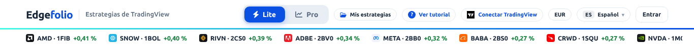
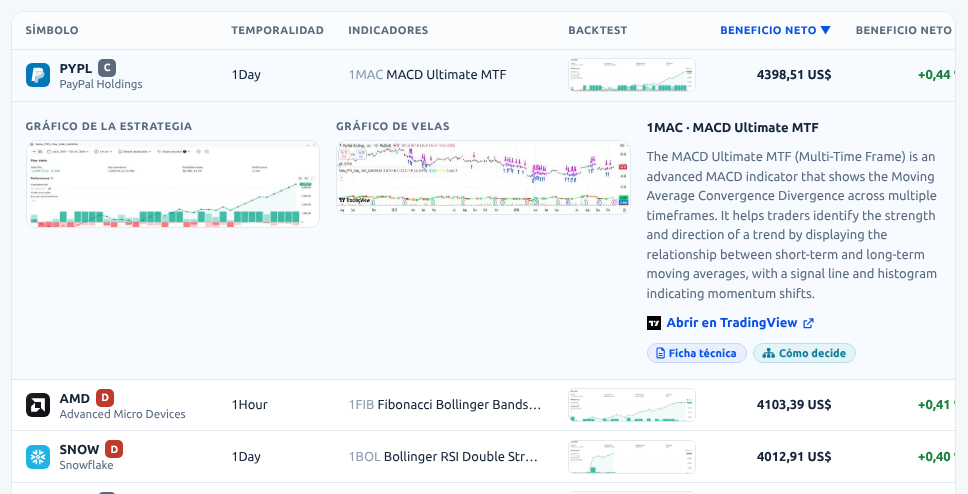
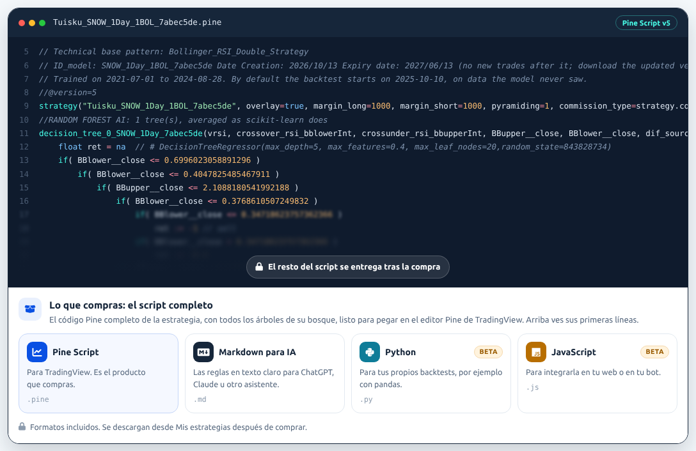
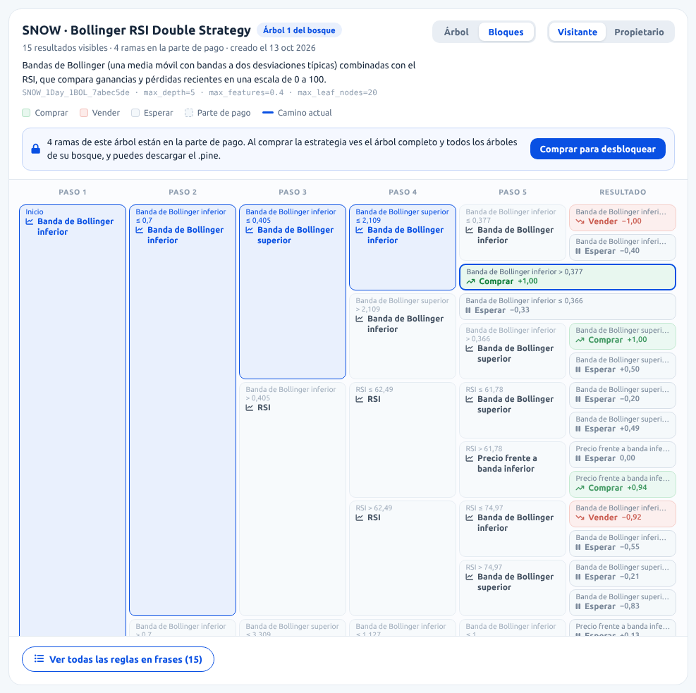
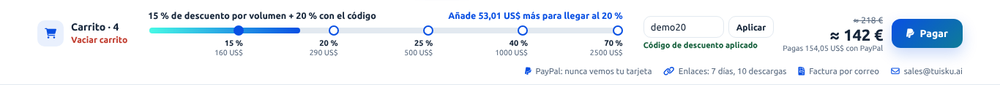
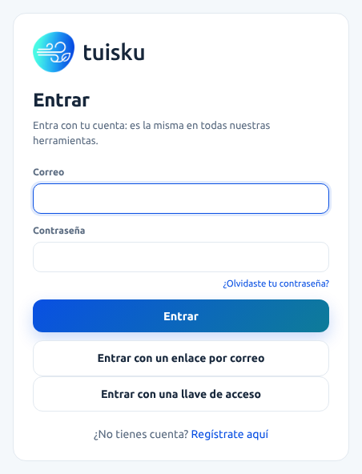

# Edgefolio · Pantallas

- **Qué es:** qué hay en cada pantalla de la tienda, tal como está programada en `_ztool_dev`: leída del código el 12 oct 2026, recorrida en un navegador y corregida el 25 y el 26 oct 2026, con el catálogo de 143 estrategias.
- **Repositorio:** `Leci37/tuisku_strategy_store`, rama `_ztool_dev`, núcleo zlecitool-core 0.31.2.
- **Numeración:** las pantallas 1–9 son las mismas en los tres documentos:
  - `PANTALLAS.md` (este): qué contiene cada pantalla;
  - `API_ENDPOINTS.md`: qué manda y qué recibe cada pantalla;
  - `FLUJO_USUARIO.md`: qué hace el usuario, clic a clic, y los estados de cada pantalla.
- `API_ENDPOINTS_referencia.md` es la referencia completa de las 22 llamadas al servidor, en inglés.

## Cuántas hay

- **9 pantallas** numeradas.
- **5 direcciones:** `/` (Lite y Pro), `/s/<id>` (ficha), `/s/<id>/tree` (Cómo decide), `/thanks` (Gracias) y `/mine` (Mis estrategias).
- **5 diálogos:** bienvenida (en la 1, y desde «Ver tutorial» en cualquier pantalla), selector del pack (en la 1), comparar (se llena en la 1 y la 2; su píldora sigue en las demás pantallas, y lo abre encima de ellas, hasta recargar), estrategia gratis (la 6) y tutorial de instalación (en la 7 y la 8).
- **Comunes a todas:** la barra superior, el pie y los avisos flotantes.

| # | Pantalla | Dónde | Tipo | Archivo en el repositorio | Archivo del diseño |
|---|---|---|---|---|---|
| 1 | Lite | `/`, modo Lite (por defecto) | página | `static/js/views/lite.js` | `Storefront v7.dc.html` |
| 2 | Pro | `/`, modo Pro | página | `static/js/views/pro.js` | `Storefront v7.dc.html` |
| 3 | Ficha de la estrategia | `/s/<id>` | página | `static/js/views/detail.js` | `Storefront v7.dc.html` |
| 4 | Cómo decide | `/s/<id>/tree` | pestaña de la ficha | `static/js/tree.js`, `static/js/views/tree/*.js` | `Strategy Tree.dc.html` |
| 5 | Carrito y pago | dentro de la 1 y la 2 | parte de página | `views/lite.js` (carrito flotante), `views/pro.js` (franja), `lib/vals_cart.js` | `Storefront v7.dc.html` |
| 6 | Estrategia gratis por correo | sobre la 1, 2, 3 o 4 | diálogo | `static/js/views/dialogs.js` | `Storefront v7.dc.html` |
| 7 | Gracias | `/thanks` | página | `static/js/views/thanks.js` | `Storefront v7.dc.html` |
| 8 | Mis estrategias | `/mine`, con sesión | página | `static/js/views/mine.js` | `Storefront v7.dc.html` |
| 9 | Móvil (390 px) | todas, por debajo de 640 px | adaptación | `static/js/views/phonebar.js` | `Storefront v7.dc.html` |

Todas usan la misma plantilla, `templates/edgefolio/shop.html`, y el estado de `static/js/app.js`.

---

## Común a todas

**Barra superior** (núcleo):
- la palabra «Edgefolio» y, al lado, «Estrategias de TradingView» (llevan a `/`); el menú de idioma («ES Español»); la cuenta y la raya de color de debajo. Sin sesión, «Entrar»; con sesión, la inicial y el correo, con su menú (Mi cuenta, Créditos, Historial de créditos, Contacto y Salir);
- **hueco del principio** (tienda): **Lite | Pro** y **Mis estrategias**;
- **hueco antes del idioma** (tienda): **? Ver tutorial**, **TradingView** («Conectar TradingView» o «TradingView ● Conectado») y la **moneda**: la del idioma (EUR en es, pt, fr y de; INR en hi; CNY en zh; SAR en ar) o USD.

**Pie** (núcleo): Privacidad, Cookies, Condiciones de uso, Aviso legal y Contacto; a la derecha, «Edgefolio» y «Estrategias de TradingView».

**Avisos flotantes** (tienda): los rechazos del servidor («No se pudo hacer»); un enlace de descarga que ya no vale; un pedido o una estrategia que no existen. Y, con su propio título, la confirmación de las novedades o su enlace caducado, y «Ya está confirmado» (pantalla 8). Se cierran con su × («Cerrar»). Con un diálogo abierto, van arriba.

No hay anuncios ni aviso de cookies.

---

## 1 · Lite

De arriba abajo:
1. **Cinta de cotizaciones:** 12 estrategias de pago, cada una con su icono, su ticker, su clave y su beneficio neto %. No se mueve sola: se desliza de lado (dedo, trackpad o teclado), sin barra.
2. **Cabecera:** un gráfico de velas difuminado de fondo, el título «Estrategias para TradingView», el subtítulo y el buscador («Busca una empresa, cripto o indicador»).
3. **Pestañas:** Destacadas, Tasa de acierto, Acciones, Cripto, Novedades · N y Gratis.
4. **Aviso «Riesgo de sobreajuste».**
5. **Packs** (cuando llegan del servidor):
   - una tarjeta por pack del catálogo: un icono por ticker, «Ahorra un N %», nombre, «N estrategias · TICKERS», precio de antes tachado, precio y **Añadir pack** («✓ En el carrito» si ya va en el carrito);
   - la tarjeta del pack propio, «Arma tu pack»: «Ahorra un N %», 5 huecos (icono o «+»), «Elige N más · 5 por ≈ 229 €» («5 por ≈ 229 €» con las 5; en USD, «5 por 249,00 US$») y **Añadir pack** (gris hasta tener 5; «En el carrito» cuando va).
6. **Tarjetas** (24 por página), cada una con:
   - icono, ticker y nombre, y la etiqueta «Novedades» si es nueva;
   - beneficio neto % con su «?»;
   - la curva de beneficio con «⚠ Backtest»;
   - tasa de acierto y operaciones, cada una con su «?», y la temporalidad y la bolsa («1Hour · NASDAQ»);
   - la nota A–D y «Desde su publicación»;
   - ♡ y **Comparar**;
   - **Ficha técnica** y **Cómo decide**;
   - el precio (US$, «≈» en moneda local o «Gratis») y **Comprar** o **Descargar**.
7. «Mostrando N de M» y **Ver más**.
8. Abajo, fijos: el **carrito flotante** (pantalla 5), si tiene algo, y la píldora **Comparar · N**, si hay algo que comparar: encima del carrito o, sin él, abajo a la izquierda.

**Diálogo de bienvenida** (3 pasos, la primera vez):
- «Paso N de 3», imagen, título y texto de cada paso: «Elige un mercado» (con seis logos de tickers del catálogo), «Lee la curva» y «Compra y cárgala en TradingView»;
- los puntos de paso, **Atrás**, **Continuar** / **Empezar** y **×** («Cerrar el tutorial»).

**Selector del pack:**
- título «Arma tu pack», contador «N / 5» y buscador («Buscar»);
- hasta 40 estrategias de pago, las elegidas arriba; cada fila con casilla, icono, «TICKER · CLAVE», indicador y beneficio neto %. Las que ya van en un pack del carrito llevan «✓ En el carrito» en lugar del %;
- **Hecho** (no tiene ×).

---

## 2 · Pro

De arriba abajo:
1. **Franja del carrito con la escalera de descuento** (pantalla 5).
2. **Panel de filtros** (a la izquierda; en el móvil, encima de la lista):
   - «143» y debajo «estrategias mostradas» («1 estrategia mostrada» con una), y **Restablecer filtros**;
   - el interruptor **Solo GRATIS**;
   - **2 rangos abiertos**, Beneficio neto ($) y Precio ($), cada uno con su histograma, un deslizador de dos asas y las casillas mín. y máx.;
   - **5 desplegables:** Símbolo, Temporalidad, Indicadores, Mercado y Fecha de publicación. Cada uno dice «N seleccionados» («1 seleccionado»), los nombres de una o dos, o «—» sin ninguna; dentro, buscador, **Seleccionar todo** / **Quitar todo** y una casilla por opción con su recuento (en Símbolo, también el icono);
   - **14 rangos plegados** (se abre uno cada vez), con lo mismo que los abiertos: Beneficio neto (%), Operaciones cerradas, Tasa de acierto (%), Factor de beneficio, Entrenamiento (meses), Pérdida máxima ($), Pérdida máxima (%), Beneficio medio ($), Beneficio medio (%), Velas medias por operación, Actividad por vela, Número de velas, Precisión f1 (%) y Profundidad del árbol. La escala de cada barra de los 16 rangos sale del catálogo.
3. **Encima de la lista:**
   - el título «Estrategias», las cuatro pestañas de orden, sin rótulo (Beneficio neto, Tasa de acierto, Precio, Operaciones cerradas), y el buscador;
   - **Filas / Tarjetas / Tabla**;
   - una etiqueta por filtro activo con su × («Quitar …»), y **Borrar filtros**;
   - el aviso de sobreajuste, en azul.
4. **La lista**, en una de tres vistas:
   - **Filas:** gráfico de velas de fondo; icono y nombre; ticker (enlace a TradingView), temporalidad y mercado; «CLAVE · indicador»; **Ficha técnica** y **Cómo decide**; la curva y 4 cifras (beneficio neto, tasa de acierto, beneficio neto %, operaciones); el precio y **Añadir al carrito** o **Descargar**.
   - **Tarjetas:** nombre, icono de TradingView y ticker (enlace a TradingView), temporalidad, mercado y precio; las dos curvas; 6 cifras (las 4 de Filas, beneficio medio y meses de entrenamiento); «CLAVE · indicador», que enlaza a la página del indicador; **Ficha de la estrategia** (la misma página que **Ficha técnica**) y los dos botones; carrito o descarga.
   - **Tabla** (más ancha que la lista: se desplaza de lado también en el escritorio):
     - columnas Símbolo (icono, ticker, nota y nombre; el ticker es un botón que abre la fila), Temporalidad, Indicadores, Backtest (minigráfico), Beneficio neto, Beneficio neto %, Tasa de acierto, Operaciones cerradas, Beneficio medio, Meses de entrenamiento, Precio y acciones (Comparar, y carrito o Descargar);
     - una fila desplegada muestra, en la parte visible, las dos curvas, el indicador con su explicación (en inglés), **Abrir en TradingView** (la página del símbolo), **Ficha técnica** y **Cómo decide**;
     - abajo, «Filas por página 25» (fijo), «a–b de N» y los botones de página.
5. En Filas y Tarjetas, «a–b de N» y **Ver más**.

**Diálogo Comparar:**
- «Comparar estrategias» y «Hasta 3 estrategias», con su × («Cerrar»);
- una columna por estrategia, con su icono, «TICKER · CLAVE» y × («Quitar TICKER · CLAVE»);
- filas de Beneficio neto (%), Tasa de acierto (%), Operaciones cerradas, Beneficio medio ($), Desde su publicación y Precio, con el mejor valor de cada fila en verde.

---

## 3 · Ficha de la estrategia

1. **Cabecera:**
   - **Volver a la tienda**;
   - gráfico de velas difuminado, icono y «Nombre · TICKER»;
   - **Abrir en TradingView** y las etiquetas de temporalidad, mercado y clave;
   - el precio y **Añadir al carrito** o **Descargar**; con la sesión abierta y la estrategia ya de la cuenta, en su lugar, «Ya es tuya · Descargar» o «Ya es tuya · Mis estrategias» (en verde), con el precio encima;
   - **Abrir en otra pestaña** y ♡ Favoritas.
2. **Pestañas:** Ficha técnica | Cómo decide (pantalla 4).
3. **Ficha técnica**, de arriba abajo:
   1. la tarjeta «Mira cómo decide esta estrategia»;
   2. la temporalidad que hay que poner en TradingView, con el nombre de su menú («1D», «1h»);
   3. el aviso de sobreajuste;
   4. **Backtest frente a resultado real:** la nota A–D y las barras del backtest y de «Desde su publicación», medidas contra el mejor backtest del catálogo, con «Aún sin medir: …» mientras no hay cálculo diario;
   5. **Versiones**, de la actual a la 1 («Primera publicación»), con «Actualización disponible» para quien tiene una anterior;
   6. el **gráfico de la estrategia** y el **gráfico de velas**;
   7. los **14 resultados del backtest:** Beneficio neto ($), Beneficio neto (%), Operaciones cerradas, Tasa de acierto (%), Factor de beneficio, Pérdida máxima ($), Pérdida máxima (%), Beneficio medio ($), Beneficio medio (%), Velas medias por operación, Fecha de publicación, Entrenamiento (meses), Temporalidad y Mercado;
   8. **Sobre el indicador:** «CLAVE · nombre», la descripción (en inglés en todos los idiomas) y «Ver el indicador en TradingView»;
   9. la **vista previa del Pine Script:** editor oscuro con el nombre del archivo y «Pine Script v5», unas líneas legibles y otras difuminadas, y el candado «El resto del script se entrega tras la compra» («… te llega gratis por correo» en una gratis);
   10. **Lo que compras** («Lo que recibes» en una gratis): los 4 formatos: Pine Script (.pine), Markdown para IA (.md), Python (.py, BETA) y JavaScript (.js, BETA), y la nota de los formatos.

---

## 4 · Cómo decide

1. **Controles:** Árbol | Bloques y Visitante | Propietario. Empieza en Propietario si la estrategia es tuya; si no, Propietario explica cómo conseguirla.
2. **Cómo se lee:** tres pasos («Cada caja hace una pregunta sobre un indicador del gráfico.», «Si la respuesta es Sí, el camino sube; si es No, baja.», «El camino termina en una acción…») y la nota del bosque.
3. **Resultado del árbol:** Comprar, Vender o Esperar con su fuerza («Parte de pago», o «Script completo» en una gratis, si el camino acaba en una rama cerrada), la barra de «Venta −1» a «Compra +1», las condiciones del camino actual, y **Ejemplo de compra** y **Ejemplo de venta**.
4. **Valores de los indicadores:**
   - la nota «Umbrales ya optimizados» y la leyenda (Compraría, Vendería, Esperaría, umbral comprobado);
   - un deslizador por indicador, coloreado según lo que haría la estrategia, con marcas en los umbrales; **No | Sí** en los de verdadero o falso; la «i» («¿Qué es …?»), con su explicación;
   - «No se usan en la parte visible: …».
5. **El árbol:**
   - «TICKER · patrón», «Árbol 1 del bosque» (un botón por árbol si el propietario ve un bosque de varios), cuántos resultados se ven y cuántas ramas son de pago;
   - una línea bajo el título explica el patrón de la estrategia, en el idioma de la página, y debajo los parámetros del modelo;
   - la leyenda: Comprar, Vender, Esperar, Parte de pago y Camino actual;
   - cajas de pregunta («¿≤ valor?» o «¿Se cumple?») con sus ramas Sí y No, en columnas «Paso 1…» y «Resultado»; cada caja dice el nombre del indicador o, si `features.json` no lo tiene, su código;
   - cajas de resultado (Comprar, Vender o Esperar) con su fuerza y una barra, y un anillo en el resultado al que se llega;
   - para el visitante, ramas grises «Parte de pago» («Script completo» en una gratis) y, encima del árbol, la caja con **Comprar para desbloquear** («Añadida al carrito» si ya va en el carrito; **Conseguirla gratis** en una gratis), que también sale en la ventana de cada rama gris.
6. **Bloques:** el mismo árbol en columnas, cada bloque con la condición que lleva a él.
7. **Ver todas las reglas en frases (N)** / **Ocultar las reglas**.
8. **El recuadro de propietario**, según la estrategia:
   - si es tuya: en verde, «Vista de propietario: este es el árbol completo…» con **Descargar .pine**;
   - si es tuya pero su script no llega: el aviso en ámbar con **Descargar .pine**;
   - si es tuya y miras como visitante: «Ya es tuya: …» y **Ver como propietario**, en vez de **Comprar para desbloquear**;
   - si no es tuya: cómo conseguirla, con **Entrar** (sin sesión) y **Comprar para desbloquear**;
   - si es gratis y no es tuya: «Script completo» y **Conseguirla gratis**, también en la vista de propietario (con **Entrar** sin sesión); si es gratis y ya es tuya, lo mismo que una comprada.
9. **Volver a la ficha técnica**.

---

## 5 · Carrito y pago

**En Lite, el carrito flotante** (abajo, fijo; solo sale con algo dentro):
- «Carrito · N» (cuenta también las estrategias de un pack) y la etiqueta «−N %» si hay descuento;
- **¿Tienes un código?**, que abre la casilla «Código», **Aplicar** y el mensaje del código;
- el subtotal tachado (solo con descuento), el total y, en moneda local, el «≈» y «Pagas X US$ con PayPal»;
- **Pagar**, con el icono de PayPal;
- la fila de confianza.

**En Pro, la franja del carrito** (arriba):
- «Carrito · N» y **Vaciar carrito**;
- el texto de la escalera («15 % de descuento por volumen + 20 % con el código»; sin tramo, «Aún sin descuento por volumen») y el siguiente tramo («Añade X US$ más para llegar al Y %»; pasado el último, «Descuento máximo alcanzado»);
- la barra con 5 marcas: 15 % / 160 US$, 20 % / 290 US$, 25 % / 500 US$, 40 % / 1000 US$ y 70 % / 2500 US$ (en español, sin punto de miles);
- la casilla «Código», **Aplicar** y el mensaje;
- el subtotal tachado (solo con descuento), el total, «Pagas X US$ con PayPal» (solo en moneda local) y **Pagar**;
- la fila de confianza.

**Fila de confianza:** «PayPal: nunca vemos tu tarjeta», «Enlaces: 7 días, 10 descargas», «Factura por correo» y sales@tuisku.ai.

Después de **Pagar** viene PayPal, fuera de la tienda.

---

## 6 · Estrategia gratis por correo (diálogo)

- **×** («Cerrar»);
- icono, «Nombre · TICKER» y «CLAVE · indicador»;
- «Consíguela gratis» y «Escribe tu correo y te enviamos el enlace de descarga.»;
- el campo **Correo**, con el error debajo;
- la casilla «Avísame también de estrategias nuevas (opcional)», sin marcar;
- **Enviarme el enlace** y el enlace Privacidad;
- al terminar: «Hecho. Mira tu correo: el enlace vale 7 días.» y **Volver a la tienda**.

---

## 7 · Gracias

1. ✓ «¡Gracias! El pago se ha completado.» y «Tus estrategias están listas para descargar.»
2. El total pagado en USD, el logo de PayPal y «Pagado con PayPal · Pedido <id>».
3. «Cada enlace vale 7 días y hasta 10 descargas. También están en Mis estrategias.» y **Descargar todo**.
4. Una fila por estrategia: icono, «Nombre · TICKER» y «CLAVE · indicador · temporalidad», **.pine**, **.zip**, **Ficha técnica ↗** y **Cómo decide ↗**. Si no eres quien compró, en su lugar salen «Tus enlaces están en Mis estrategias» (`linksHiddenTitle`), `linksHiddenText` y **Entrar para descargar** (`signInToDownload`).
5. «Añádela a TradingView», **Ver el tutorial** y 5 casillas, una por paso; solo si se ven los enlaces.
6. **Ir a Mis estrategias**, **Volver a la tienda** y «¿Problemas? sales@tuisku.ai».

**Tutorial de instalación** (diálogo, 5 pasos, «Paso N de 5»):
1. Descarga y copia el script.
2. Entra en TradingView.
3. Abre el gráfico correcto, con el enlace «Abrir TICKER en TradingView».
4. Pégalo en el Pine Editor.
5. Añádela al gráfico.

Cada paso lleva su imagen, título y texto. Debajo, los puntos (se pueden pulsar), **Atrás**, **Continuar** / **Listo** y **×** («Cerrar el tutorial»).

---

## 8 · Mis estrategias

- **Arriba:** el título, «Todo lo que has comprado o descargado, con su enlace.» (`mineSub`), «Has entrado como <correo>» y **Salir**.
- **¿Compraste sin cuenta?** (`proofTitle`, `proofText`). Sale solo cuando el correo de la cuenta no está demostrado en la tienda, o tras un enlace usado o caducado:
  - con un enlace usado o caducado, la nota `errProofExpired` arriba;
  - el campo del correo (el de la cuenta, por defecto), con el error debajo, «Enviarme el enlace» y el enlace de Privacidad;
  - tras enviar, solo `proofSent`;
  - al abrir el enlace del correo, en su lugar: «Confirma tu correo» (`proofConfirmTitle`), el texto `proofConfirm`, el botón «Sí, <correo> es mío» (`proofAs`) y Privacidad.
- **Una fila por estrategia**, aunque se comprara dos veces o se renovara su enlace; la más reciente arriba:
  - icono, «Nombre · TICKER» y «CLAVE · indicador · temporalidad»;
  - «Comprada el …» o «Descarga gratuita el …», de la primera vez, y el pedido si se pagó;
  - «Enlace válido N días más» o «El enlace caducó»;
  - **.pine** y **.zip**, o **Pedir un enlace nuevo**;
  - **Obtener la actualización · vN**, si hay una versión nueva;
  - **Ficha técnica ↗** y **Cómo decide ↗**.
- **Favoritas:** icono, «TICKER · CLAVE» (abre la ficha), las alertas **Versión nueva**, **Bajada de precio** y **En un pack**, y ♥. Sin favoritas: «Pulsa el corazón de una estrategia para seguirla.»
- **Abajo:** **Añádela a TradingView** (solo con algo en la lista) y **Volver a la tienda**.
- Sin sesión, la página de entrar del núcleo (`/login?next=/mine`):

---

## 9 · Móvil (390 px)

**Barra de abajo** (fija, 61 px, con botones de 44 px): **Tienda**, **Buscar**, **Carrito** (con el número) y **Mías**. Tienda y Mías salen en azul en su pantalla. No sale en las páginas del núcleo (entrar, «Mi cuenta», «Mis datos»).

**Cómo cambian las demás pantallas:**
- la barra del núcleo ocupa cuatro filas (165 px) y se queda arriba al bajar;
- las tarjetas van en una columna, y las de la ficha, una debajo de otra;
- el panel de filtros de Pro va encima de la lista, y la Tabla se desplaza de lado dentro de su caja;
- el carrito flotante y la píldora Comparar suben a 76 px del borde (en Lite, con algo en el carrito, Comparar va dentro del carrito flotante), y los avisos van encima de ellos;
- los deslizadores de Cómo decide van encima del árbol;
- las 5 casillas de Gracias van una debajo de otra;
- los diálogos ocupan el ancho menos 16 px por lado, y su velo tapa la barra de abajo.
