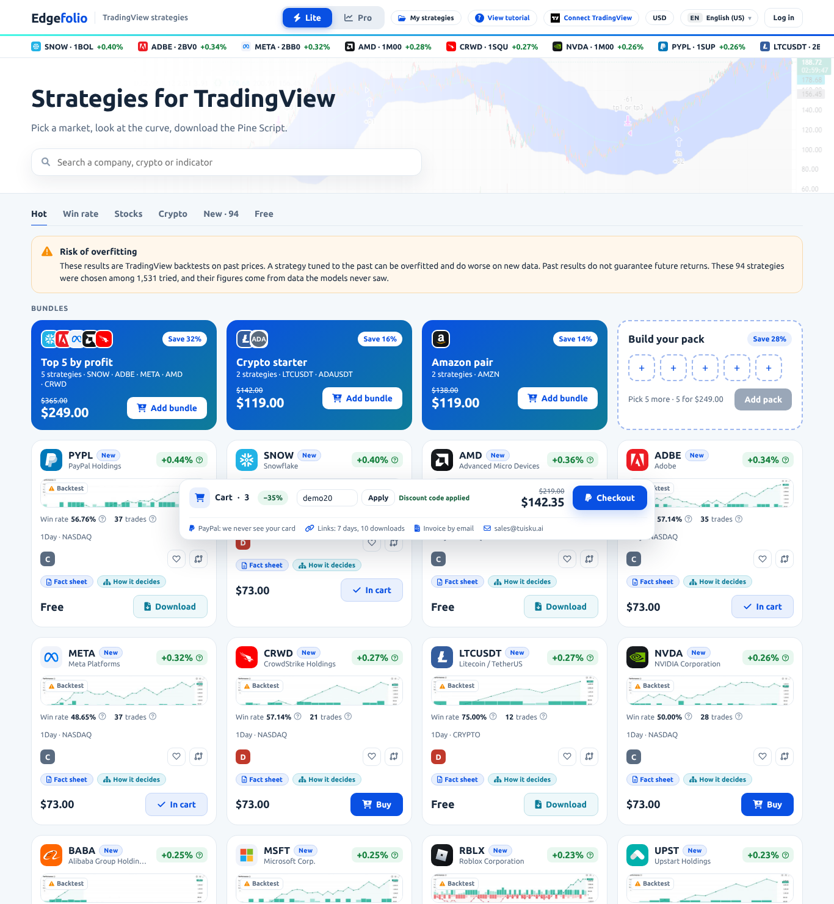

# Páginas · Edgefolio

La tienda es su propia web comercial: no hay portada (`templates/landing.html`) ni otras páginas de venta. Quien
llega a `/` entra en Lite, y lo que vende está repartido por la tienda. Aquí, sección a sección, sólo lo que
vende (lo demás, en `docs/PANTALLAS.md`); sus textos, con su clave, en [MESSAGES.md](../MESSAGES.md). Todo
está en `templates/edgefolio/shop.html` y sus vistas (`static/js/views/`), sobre `zt/base.html` del núcleo.

La captura es de `tools/screenshots.py` (en `docs/img/`, la del README); la venta aún no tiene las suyas en
`web/img/`.

1. **La barra** (del núcleo): la palabra Edgefolio y «Estrategias de TradingView»; los chips de la tienda (Lite |
   Pro, Mis estrategias, ? Ver tutorial, Conectar TradingView, la moneda), el idioma y «Entrar».
2. **La cinta de tickers**, con la curva de cada uno.
3. **La cabecera de Lite**: «Estrategias para TradingView», «Elige un mercado, mira la curva y descarga el Pine
   Script.» y el buscador.
4. **Las pestañas**: Destacadas, Tasa de acierto, Acciones, Cripto, Novedades y Gratis.
5. **El aviso de sobreajuste**: el riesgo, entre cuántas probadas se eligieron y que sus cifras salen de datos que
   los modelos no vieron.
6. **Los packs**: los lotes con «Ahorra un N %» y «Arma tu pack».
7. **Las tarjetas**: la curva, la nota, la tasa de acierto, las operaciones y el precio (o «Gratis»), con
   Comparar y Favorita; «Ya es tuya» en lo que ya es de la cuenta.
8. **El recorrido de bienvenida** (la primera visita, y con «? Ver tutorial»): Elige un mercado, Lee la curva,
   Compra y cárgala en TradingView.
9. **El carrito y la fila de confianza** bajo «Pagar»: PayPal, los enlaces y el recibo
   ([MESSAGES.md](../MESSAGES.md): dice «Factura por correo»).
10. **Gracias** (después de pagar): las descargas y el tutorial de instalación en cinco pasos.
11. **El pie** (de la carcasa): lo legal y Contacto.

**El SEO**: lo pone el núcleo con la ficha (`name` y `description` de `tool.json`) y el título de la pestaña
(«Edgefolio · Estrategias de TradingView»; en la ficha, la estrategia). Sin `web/SEO.md` todavía.

**Los vídeos:** cuando la guía de usuario esté en YouTube ([videos/VIDEOS.md](../videos/VIDEOS.md)), su enlace
iría dentro de la tienda, como un enlace o una miniatura que lleva a YouTube (la CSP del núcleo no deja cargar el
reproductor): dónde, en [IDEAS.md](../IDEAS.md).
